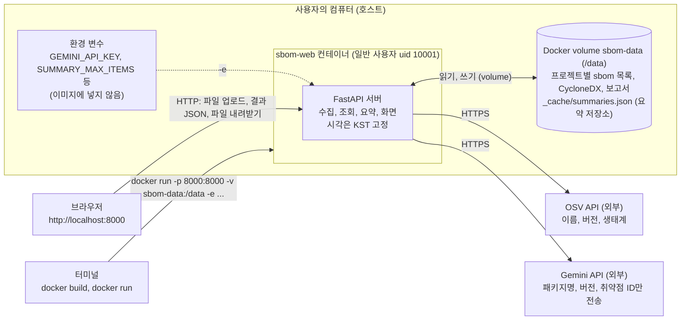
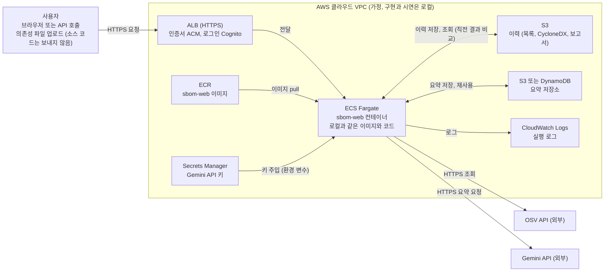

# 개발 문서

요구사항, 완료 기준, 설계를 정하고 구현 결과로 개정한 개발 문서이다. 본인 말로 고쳐 쓰고 설명할 수 있어야 한다. 구현 때 확인한 항목의 결과는 4.5, 구현하면서 바뀐 점은 5.1, 요구사항별 결과는 5.2, 남은 문제는 5.3, 진행 현황은 5.4, 완료 기준 82개 사례의 확인 결과는 5.5에 있다. 길어서 옮긴 상세 내용(요구사항 세부 규칙, 확인 사례 전체, 변경 기록 전문, 결과 상세)은 [부록](appendix.md)에 있다.

**현재 상태(2026-11-10)**: T1~T14 구현을 마쳤고 완료 기준 82개 사례를 모두 확인했다. 실제 Gemini 5건 묶음 요약 성공, 사례 39의 실패 사유(토큰 부족), 컨테이너에서 실제 키로 끝까지 실행한 것은 하루 요청 한도가 풀린 2026-11-10에 확인했다(5.3). 남은 미확인은 50건 규모(10회 호출)의 전체 응답 시간이다. 코드는 GitHub 저장소 `jjin2024/final_sbom-web`(비공개)의 `sbom-web/` 폴더에 있고 실행 방법은 그 `README.md`에 있다.

## 0. AI 사용 기록
| 날짜 | 사용한 곳 | 내용 |
|---|---|---|
| 2026-11-02 | Claude | 주제 검토, 시나리오·요구사항·완료 기준·설계 초안 작성과 보완(Peer review 피드백 반영) |
| 2026-11-09 | Claude | 구현 형태를 웹 서비스로 바꾸는 방안 검토, 문서 개정, 클라우드 활용 설명(4.6) 작성 |
| 2026-11-09~12 | Claude Code | 설계에 따른 구현과 시험(T1~T14), 실제 OSV·Gemini 호출 확인, 개발 문서 정리 |
| 2026-11-09 | Manus | 화면(`index.html`) 초안 생성. 스크립트 오류와 접근성 문제는 Claude Code로 수정 |

## 1. 주제와 사용 시나리오
- 프로젝트명: SBOM 작성 + 취약점 점검 도구 (웹 서비스)
- 대상 사용자: 개발자, 보안 담당자
- 해결할 문제: 오랜 기간 혹은 AI를 활용해 개발하다보면 어떤 패키지를, 어떤 라이브러리를, 어떤 버전을 썼는지 잊을 수 있다. 소프트웨어 취약점이 매일 1건 이상 나오는 지금, 개발할 때마다 직접 SBOM을 작성하고 업데이트하는 것은 어렵다.
  - 매번 SBOM 작성, 업데이트하기 어려움
  - 사용 중인 소프트웨어가 취약점이 있는지 직접 확인하기 어려움
  - 취약점 ID만 보아서는 어떤 영향이 있고 어느 버전으로 올려야 하는지 바로 알기 어려움
  - 점검 결과를 남기지 않으면 지난번과 무엇이 달라졌는지, 취약점이 늘었는지 줄었는지 추적하기 어려움
- 이 문서에서 "SBOM"의 범위: 업로드한 파일에 적힌 구성요소의 목록이다. 선언 파일(requirements.txt, package.json, go.mod)은 직접 의존성만, 잠금 파일(package-lock.json, Cargo.lock)은 그 안의 전이 의존성까지 포함한다. 해시, 라이선스, 공급자 정보는 포함하지 않는다.
- 기대하는 개선: 웹 화면에서 의존성 파일(requirements.txt, package-lock.json 등)을 올리면 패키지·버전 구성요소 목록을 자동으로 작성하고 표준 SBOM 형식(CycloneDX)으로도 내려받는다. 이전 점검과 비교해 변경을 보여 준다. OSV로 알려진 취약점을 확인한 뒤 심각도가 높은 항목부터 AI(Gemini)가 설명과 조치 권장을 요약한다. 프로젝트별 점검 이력을 보존한다.

### 대표 사용 시나리오
| 상황 | 사용자의 행동과 기대 결과 |
|---|---|
| 이전 | 프로그램 개발에 사용한 소프트웨어 버전을 직접 작성해 매번 반영하기 어려움 |
| 점검 요청 | 웹 화면에서 프로젝트 이름을 적고 `requirements.txt`를 올리면 패키지·버전 목록이 프로젝트의 `sbom-<시각>.txt`로 저장 |
| 표준 형식 내려받기 | 같은 점검의 구성요소 목록을 CycloneDX JSON으로 내려받아 다른 도구에 넘김 |
| 변경 확인 | 같은 프로젝트의 직전 목록과 비교해 추가, 삭제, 버전 변경을 확인 |
| 이력 확인 | 프로젝트 이름으로 과거 점검 목록을 최신순으로 보고 목록과 보고서를 내려받음 |
| 취약점 확인 | 공개 취약점 DB를 조회해 취약 항목을 심각도 순으로 화면에 최대 15행 표시하고 보고서에 전체 저장 |
| 조치 이해 | 심각도가 높은 취약점부터 AI 요약과 업그레이드 권장을 확인 |
| 요약 일부 실패 | 항목별 요약 상태를 표시하고 성공한 요약과 취약점 표는 유지 |
| 조회 장애 | 목록 파일은 유지하고 조회 실패를 안내. 해당 요청의 보고서는 만들지 않음 |
| 재요청 | 새 시각의 결과 파일을 만들고 이전 파일을 유지 |
| 결과 표시 | 화면에 점검 결과와 조치 요약을 출력하고, `sbom-<시각>.txt`와 `vuln-report-<시각>.txt`를 서버의 `/data/<프로젝트>/`에 저장 |

### Case study
- 누가 언제 어떤 목적으로 사용하는가?
  - 개발자와 보안 담당자가, 배포하거나 저장소에 올리기 전과 의존성을 바꾼 뒤에, 프로젝트가 쓰는 패키지와 버전을 파악하고 알려진 취약점이 있는지 확인하려고 사용한다.
- Pain point의 개선점이 자연스럽게 연결되는가?
  - 패키지와 버전을 파악하기 어렵다는 불편은 목록 자동 생성과 표준 형식 출력으로, 취약한 버전을 모른다는 불편은 취약점 DB 조회로, 조치를 모른다는 불편은 AI 요약으로, 지난번과의 차이를 모른다는 불편은 이력과 이전 실행 대비로 각각 해결되므로 불편과 개선점이 연결된다.
- 사용 후 어떤 불편이 줄어드는가?
  - 폴더마다 매니페스트를 열어 직접 정리하고 취약점을 따로 검색하던 일이, 파일 하나를 올려 목록과 취약점 확인 결과를 받는 것으로 줄어든다.

### 개발 방식
Spiral 모델

## 2. 요구사항
설정
- 대상 입력: 의존성 파일 1개. 파일 이름으로 형식을 정한다: `package-lock.json`, `package.json`(Node.js, 생태계 npm), `go.mod`(Go), `Cargo.lock`(Rust, 생태계 crates.io). 이 이름이 아니면 이름과 상관없이 `requirements.txt` 형식(Python, 생태계 PyPI)으로 해석한다. 선언 파일(`requirements.txt`, `package.json`, `go.mod`)은 직접 의존성만, 잠금 파일(`package-lock.json`, `Cargo.lock`)은 그 안의 전이 의존성까지 담는다.
- 번호 규칙: 같은 분류의 연관된 요구사항은 `R1`, `R1-2`, `R1-3`처럼 번호를 이어 붙인다.
- 프로젝트 이름 규칙: 영문, 숫자, `.`, `_`, `-`만 쓰고 영문 또는 숫자로 시작하며 1~50자. 이름이 서버의 폴더 이름이 되므로 경로를 바꾸는 문자(`/`, `..`, 공백)를 막는다.
- 결과 파일 규칙: 서버의 데이터 폴더 `/data/<프로젝트>/`(없으면 생성)에 `sbom-YYYYMMDD-HHMMSS.txt`, `sbom-YYYYMMDD-HHMMSS.cdx.json`(표준 SBOM 형식 CycloneDX), `vuln-report-YYYYMMDD-HHMMSS.txt`로 저장한다. 시각은 요청을 받은 시점에 한 번만 정해서 세 파일이 공유하며, 이 시각이 스캔 ID(`YYYYMMDD-HHMMSS`)이다. 파일명에 콜론(`:`)은 쓰지 않는다. 시각은 한국 시간(KST, UTC+9)으로 고정하고, 파일 안의 실행 시각에는 `KST`를 함께 적는다. 시간대를 고정하므로 파일명 순서가 요청 순서와 일치한다. 업로드한 원본 파일은 저장하지 않는다.
- 버전 관리 방식: 요청마다 목록 수집과 취약점 조회를 전체 새로 수행해 새 시각의 결과 파일을 만든다. 취약점은 파일이 그대로여도 새로 등록되므로 변경된 파일만 조회하지 않는다. 변경 확인은 같은 프로젝트 폴더의 직전 `sbom-<시각>.txt`와 비교해서 한다(R2-4).
- 서버는 요청 사이에 상태를 기억하지 않는다(stateless). 이력은 모두 데이터 폴더의 파일로만 남는다.

### 2.1 요구사항 목록
"확인 사례"는 3장의 완료 기준 사례 번호이다.

| 분류 | 번호 | 선행 | 요구사항 | 확인 사례 |
|---|---|---|---|---|
| 1. 수집 | R1 | 없음 | 업로드한 파일과 프로젝트 이름을 받아 패키지와 버전 수집 | 1, 2 |
| | R1-2 | R1 | 입력 검증과 오류 안내 (프로젝트 이름, 파일 유무, 크기 상한, 텍스트 여부, 파일 형식, 패키지 0건) | 3, 4, 5, 6, 7, 57, 64 |
| | R1-3 | R1, R3 | 확정 버전이 없는 항목(범위 표기, 버전 없음)을 표시하고 조회에서 제외(모든 파일 종류에 적용) | 8, 54, 68 |
| | R1-4 | R1 | 해석할 수 없는 줄은 건너뛰고 건너뛴 줄 수를 안내. extras가 붙은 줄(`flask[async]==3.0.0`)은 이름과 버전으로 읽음 | 9, 66, 67, 68 |
| | R1-5 | R1, R1-2 | 입력 파일 종류 확대: 파일 이름으로 `package-lock.json`, `package.json`, `go.mod`, `Cargo.lock`을 구분해 해석(생태계 npm, Go, crates.io). 이름과 내용이 맞지 않으면 거절. 항목이 수백 건인 잠금 파일을 위해 OSV 조회를 동시에 수행 | 53~65, 72 |
| 2. 결과 파일 관리 | R2 | R1, R1-2 | 패키지 목록을 프로젝트별로 `/data/<프로젝트>/sbom-<시각>.txt`에 저장하고 스캔 ID 반환 | 10, 11, 12 |
| | R2-2 | R2 | 프로젝트의 이력 목록(최신순) 조회, 과거 목록·보고서 내려받기 | 13, 14, 15 |
| | R2-3 | R2 | 재요청 시 새 시각의 결과 파일을 만들고 기존 파일은 유지, 같은 시각 충돌은 거절 | 16, 17 |
| | R2-4 | R2, R2-3 | 같은 프로젝트의 직전 `sbom-<시각>.txt`와 비교해 추가, 삭제, 버전 변경을 표시. PyPI 이름은 PEP 503 규칙으로 정규화해 비교 | 18~22, 60, 69, 70, 71 |
| | R2-5 | R2 | 같은 점검의 구성요소 목록을 표준 SBOM 형식 CycloneDX 1.5 JSON(`sbom-<시각>.cdx.json`)으로도 저장하고 내려받기(응답의 링크, 이력 목록, 내려받기 API) | 45~51 |
| 3. 취약점 조회 | R3 | R1 | 패키지·버전·생태계(PyPI, npm, Go, crates.io)로 취약점 DB(OSV 등)를 조회하되 같은 패키지·버전은 한 번만 조회 | 23, 24, 25, 61, 62, 63 |
| | R3-2 | R2, R3 | 조회 결과를 화면용 표(상위 15행)로 응답하고 `/data/<프로젝트>/vuln-report-<시각>.txt`에 전체를 저장 | 26~29 |
| | R3-3 | R2, R3 | 조회 실패 시 목록 파일 유지, 실패 안내 | 30 |
| 4. AI 요약 | R4 | R3, R3-2 | 취약점을 심각도 높은 순으로 최대 50건, 5건씩 묶어 AI(Gemini)로 요약하고 한도 초과 항목은 요약 없이 표에 명시 | 31~36 |
| | R4-2 | R4 | AI 요약 실패 시 어디까지 되고 어디부터 안 됐는지 항목별로 표시, 취약점 표는 유지. 사용 한도 초과·인증 오류(HTTP 429, 401, 403)면 남은 묶음을 요청하지 않음 | 37~39, 79 |
| | R4-3 | R4 | 이미 요약한 항목(패키지, 버전, 취약점 ID)의 요약을 저장해 두었다가 다음 요청에서 호출 없이 다시 사용하고, 호출 횟수와 재사용 건수를 표시 | 74~78, 80~82 |
| 5. 실행·배포 | R5 | R1, R2, R3, R3-2 | Docker 이미지로 웹 서버를 실행하고 데이터 폴더는 volume으로 유지 | 40, 41, 42 |
| 6. 화면 | R6 | R3-2, R5 | 브라우저 화면에서 프로젝트 이름과 파일을 올려 요청하고 결과(표준 형식 내려받기 링크 포함)를 확인 | 43, 52, 65 |
| | R6-2 | R2-2, R6 | 화면에서 이력 목록과 과거 결과 내려받기, 오류 사유 표시 | 44 |

### 2.2 요구사항 상세
| 번호 | 입력 | 정상 처리 | 거절·실패 조건 | 대응 |
|---|---|---|---|---|
| R1 | 프로젝트 이름, 업로드한 텍스트 파일 1개 (파일 이름이 `package-lock.json`, `package.json`, `go.mod`, `Cargo.lock`이면 그 형식으로, 아니면 이름과 상관없이 내용을 `requirements.txt` 형식으로 해석) | 형식에 맞게 해석해 패키지명, 버전, 생태계(PyPI, npm, Go, crates.io) 수집. 업로드한 파일은 읽기만 하고 저장하지 않는다 | 거절 조건은 R1-2 | R1-2 참조 |
| R1-2 | 프로젝트 이름, 업로드 파일, 업로드 크기 상한(기본 1MB, 환경 변수로 변경 가능) | 검증 통과 시 진행 | 프로젝트 이름이 규칙에 맞지 않음, 파일이 없음, 크기 상한 초과, 텍스트(UTF-8)로 읽을 수 없음, 지원하는 파일 이름인데 내용이 그 형식이 아님(JSON·TOML 구문 오류, lockfileVersion 1 등), 해석된 패키지가 0건(빈 파일, 주석만 있는 파일, 모두 해석할 수 없는 줄) | 오류 응답(이름·파일·형식은 400, 크기 초과는 413)과 사유 안내, 데이터 폴더에 아무것도 만들지 않음, 기존 이력은 유지, 외부 호출 없음 |
| R1-3 | 패키지의 버전 표기 | 확정 버전만 조회(requirements.txt 형식은 `==`, package.json은 `x.y.z`, 잠금 파일·go.mod·Cargo.lock은 모든 항목). 범위 표기(예: `>=2.0`, `~=1.4`, `^4.18.0`)는 목록 파일에 원문 그대로, 버전 지정이 없으면 `-`로 기록하고 뒤에 `(확정 버전 아님)`을 붙임 (예: `flask >=2.0 PyPI (확정 버전 아님)`) | 확정 버전이 없음 | 조회에서 제외하고 제외한 개수를 응답에 안내 |
| R1-4 | 파일의 각 줄 | 해석할 수 있는 줄만 수집. 빈 줄과 주석은 정상적으로 무시. 이름 바로 뒤에 붙은 extras(`flask[async]==3.0.0`)는 버리고 이름과 버전만 읽음 | 해석할 수 없는 줄(예: 다른 파일을 가리키는 `-r` 줄, git 주소 줄, 닫히지 않은 대괄호 `flask[async==3.0`, 공백이 낀 `name [extra] == 1.0`) | 그 줄만 건너뛰고 건너뛴 줄 수를 응답에 안내(빈 줄과 주석은 세지 않음), 나머지 줄은 계속 처리 |
| R1-5 | 프로젝트 이름, `package-lock.json`, `package.json`, `go.mod`, `Cargo.lock` 중 하나 | 파일 이름으로 형식을 정해 해석(규칙은 2.2.4). 항목은 R1과 같은 구조(이름, 버전, 생태계, 확정 여부)이고 이후 단계(조회, 목록 파일, 비교, 보고서, 요약)는 형식과 상관없이 같다 | 이름은 지원하는 이름인데 내용이 그 형식이 아님(JSON·TOML 구문 오류), lockfileVersion 1, 항목 0건 | 400 "형식을 해석할 수 없음", "지원하지 않는 lockfile 버전", "패키지를 찾을 수 없음". 아무것도 저장하지 않고 외부 호출 없음(R1-2와 같은 처리) |
| R2 | R1의 수집 결과, 프로젝트 이름, 요청 시각(KST) | 패키지 목록만 `/data/<프로젝트>/sbom-<시각>.txt`에 저장 (이름, 버전, 생태계). 같은 줄이 여러 번 나오면 줄마다 기록. 파일 안에 프로젝트와 실행 시각을 `KST`와 함께 기록. 프로젝트 폴더가 없으면 생성. 새 취약점이 등록되어도 목록은 바뀌지 않는다. 응답에 스캔 ID 포함 | 데이터 폴더에 쓸 수 없음 | 오류 응답(500)과 안내, 불완전한 파일을 남기지 않고 이후 단계를 진행하지 않음(비교와 조회가 이 파일에 기대므로) |
| R2-2 | 프로젝트 이름, (선택) 스캔 ID | 프로젝트 폴더의 스캔을 최신순으로 나열(스캔 ID, 시각, 보고서 유무). 스캔 ID를 주면 그 스캔의 목록 파일과 보고서 파일 내용을 돌려줌 | 프로젝트 이름 규칙 위반, 스캔 ID나 보고서가 없음 | 규칙 위반은 400. 이력이 없는 프로젝트는 빈 목록(200). 없는 스캔 ID와 없는 보고서는 404 |
| R2-3 | 같은 프로젝트로 재요청 | 새 시각의 두 결과 파일을 만들고 기존 파일은 유지 | 같은 시각(초)에 같은 프로젝트로 요청되어 파일명이 겹침 | 기존 파일을 덮어쓰지 않고 오류 응답(409)과 안내, 이후 단계 진행 안 함 |
| R2-4 | 이번 요청의 수집 결과, 같은 프로젝트 폴더의 직전 `sbom-<시각>.txt`(파일명의 시각이 이번 요청보다 이른 것 중 가장 늦은 것) | (패키지명, 생태계)를 기준으로 비교해 추가, 삭제, 버전 변경, 변경 없음 건수와 항목을 응답에 표시하고 `sbom-<시각>.txt` 끝의 "이전 실행 대비" 구역에 기록. 범위 표기도 표기 문자열이 달라지면 버전 변경으로 본다. 비교 키를 만들 때만 PyPI 이름을 PEP 503 규칙으로 정규화하므로 이름 표기만 다른 같은 패키지는 변경 없음이다(npm, Go, Rust 이름은 정규화하지 않음). 다른 프로젝트의 스캔은 비교 대상이 아니다 | 직전 파일이 없음(첫 요청), 직전 파일을 읽거나 해석할 수 없음 | 첫 요청이면 "비교 대상 없음" 안내. 읽을 수 없으면 비교만 건너뛰고 안내. 두 경우 모두 이후 단계는 계속 진행 |
| R2-5 | R2의 수집 결과, 프로젝트 이름, 요청 시각(KST) | 목록 파일을 저장한 뒤 같은 스캔 ID로 `/data/<프로젝트>/sbom-<시각>.cdx.json`을 저장(CycloneDX 1.5 JSON, 구성요소 목록만, 취약점 정보 없음, 형식은 2.2.5). 응답의 `links.cyclonedx`, 이력 목록 항목의 `links.cyclonedx`, `GET .../scans/{scan_id}/cyclonedx`로 내려받음 | CycloneDX 파일 저장 실패. 입력 검증 실패, 목록 저장 실패, 같은 시각 충돌 | 저장 실패는 목록 파일과 보고서가 정상이고 201에 경고(`warnings`) "CycloneDX 파일 저장 실패", `links.cyclonedx`는 null, 불완전한 파일을 남기지 않음. 앞의 세 경우는 만들지 않음. 파일이 없는 과거 스캔은 `links.cyclonedx`가 null이고 내려받기는 404 |
| R3 | 패키지명, 버전, 생태계(PyPI, npm, Go, crates.io) | (이름, 버전, 생태계)가 같은 항목은 한 번만 조회. 사실 조회는 검증 가능한 취약점 DB로 한다. 해당 버전에 영향을 주는 취약점 ID와 심각도를 받는다. 이전 요청에서 변경이 없던 패키지도 매번 다시 조회한다 | 네트워크 오류, 타임아웃, 응답 오류 | R3-3 참조 |
| R3-2 | R3의 조회 결과, 요청 시각(KST) | 취약점을 심각도 높은 순(심각 > 높음 > 보통 > 낮음, 같은 심각도는 취약점 ID 순, 심각도 없음은 맨 뒤)으로 정렬. 응답에 표(패키지, 버전, 생태계, 취약점 ID, 심각도, 요약 상태, 요약)를 상위 15행까지 담고 전체 건수와 생략한 건수를 함께 알려 "외 N건은 보고서 참조"로 안내. `/data/<프로젝트>/vuln-report-<시각>.txt`에는 전체 항목을 조회 시각(KST)과 함께 저장(R2와 같은 시각). 취약점이 없으면 "발견된 취약점 없음" 표시 | 보고서 파일에 쓸 수 없음 | 표를 포함한 정상 응답에 경고(`warnings`)로 "보고서 파일 저장 실패" 안내 |
| R3-3 | 조회 실패 | 목록 파일(`sbom-<시각>.txt`)은 정상 저장 | 조회 실패 | 오류 응답(502)에 스캔 ID와 "조회 실패, 목록은 저장됨" 안내. 그 요청의 `vuln-report-<시각>.txt`는 만들지 않음. 이전 요청의 파일은 영향받지 않음. 요약 호출 없음 |
| R4 | R3-2의 취약점 목록, API 키(환경 변수) | 심각도 높은 순으로 최대 50건을 5건씩 묶어 요청하고, 항목별 설명과 업그레이드 권장을 받아 응답의 표와 `vuln-report-<시각>.txt`에 포함. 한도 초과 항목은 요약하지 않고 표에 "요약 제외(한도 초과)"로 명시 | API 키가 없음, 요약할 취약점이 없음 | 키가 없으면 요약을 건너뛴다는 안내와 함께 모든 항목의 상태를 "요약 안 함(API 키 없음)"으로 표시, 취약점이 없으면 요약 단계 생략 표시. 취약점 표와 보고서는 정상 |
| R4-2 | 묶음별 요약 응답 | 정상 완료 응답이면 해당 묶음의 항목을 "요약됨"으로 표시 | 정상 완료가 아닌 응답 (인증 오류, 타임아웃, 응답이 중간에 잘림 등) | 해당 묶음의 항목만 "요약 실패"로 표시하고 성공한 묶음의 요약은 유지, 이후 묶음은 계속 시도, 집계 표시. 취약점 표는 유지. 단 실패 원인이 HTTP 429, 401, 403이면 남은 묶음은 요청하지 않고 남은 대상 항목도 "요약 실패"로 표시(집계의 실패 건수에 셈) |
| R4-3 | 요약 대상 항목(패키지명, 버전, 취약점 ID), 저장된 요약(`/data/_cache/summaries.json`) | 대상 중 저장된 요약이 있는 항목은 호출 없이 "요약됨(재사용)"으로 채우고 나머지만 5건씩 묶어 요청. 새로 "요약됨"이 된 항목은 저장. 집계 문장은 그대로이고(재사용분은 성공에 포함) 그 옆에 `요약 호출 N회, 재사용 N건`을 표시 | 저장된 요약이 TTL(기본 30일)보다 오래됨, 프롬프트 형식 버전이 다름, `SUMMARY_CACHE_TTL_DAYS=0`, API 키 없음, 캐시 파일이 깨졌거나 읽을 수 없음, 캐시 저장 실패 | 오래됨·형식 다름·TTL 0이면 재사용하지 않고 새로 요약(TTL 0이면 저장도 안 함). 키가 없으면 지금처럼 모든 항목을 "요약 안 함(API 키 없음)"으로 처리하고 캐시를 쓰지 않음. 파일이 깨졌으면 무시하고 새로 만듦. 저장에 실패하면 점검은 정상(201)이고 `warnings`에 "요약 캐시 저장 실패". "요약 실패", "요약 제외", "요약 안 함" 상태는 저장하지 않음 |
| R5 | 포트 매핑, 데이터 volume, API 키(환경 변수) | `docker run`으로 웹 서버 컨테이너를 실행하면 같은 컴퓨터의 브라우저나 HTTP 요청으로 접근할 수 있다. `/healthz`로 기동을 확인한다. 이력은 volume의 `/data`에 저장되어 컨테이너를 지우고 같은 volume으로 다시 실행해도 유지된다. 파일명 시각은 KST 기준 | API 키 없이 실행, volume 없이 실행 | API 키가 없어도 서버는 기동하고 요약만 건너뜀(R4). volume 없이 실행하면 이력이 컨테이너와 함께 사라지므로 실행 안내에 `-v`를 명시 |
| R6 | 화면의 프로젝트 이름, 선택한 파일 | 전송하면 점검 요청(POST)을 보내고 진행 중임을 표시, 결과(수집 건수, 건너뛴 줄 수, 조회 제외 건수, 이전 실행 대비, 취약점 표와 요약 상태, 요약 집계, 경고, 다운로드 링크)를 표시 | 오류 응답 | R6-2 참조 |
| R6-2 | 프로젝트 이름(이력 조회), 서버의 오류 응답 | 이력 목록(최신순)을 표시하고 항목마다 목록 파일과 보고서를 내려받는 링크를 제공 | 오류 응답(400, 409, 413, 500, 502), 서버에 연결할 수 없음 | 사유를 화면에 메시지로 표시(서버 내부 정보나 스택 트레이스는 표시하지 않음), 연결 불가는 "서버에 연결할 수 없음" 표시 |

세부 규칙(2.2.1~2.2.5)은 길어서 [부록 A](appendix.md#부록-a-요구사항-세부-규칙-본문-221225)로 옮겼다. 이 문서 곳곳에서 "2.2.2", "2.2.4"처럼 부르는 번호는 부록 A의 소제목 번호이다. 핵심만 적으면 다음과 같다.

| 구분 | 핵심 규칙 |
|---|---|
| 요약(R4, R4-2, R4-3) | 심각도 높은 순으로 최대 50건을 5건씩 묶어 요청하고(패키지명, 버전, 취약점 ID만 전송), 캐시에 있는 항목은 호출 없이 "요약됨(재사용)"으로 채운다. 한 묶음이 실패해도 다음 묶음을 시도하지만 HTTP 429, 401, 403이면 남은 묶음을 요청하지 않는다. 집계는 `요약 N건 성공, N건 실패, N건 제외`와 `요약 호출 N회, 재사용 N건`(2.2.1) |
| 취약점 조회(R3, R3-2) | OSV `/v1/query`, 같은 취약점의 GHSA·PYSEC 별칭을 하나로 합침. 심각도는 문자열 등급, 없으면 CVSS v3 점수, 그 외 "알 수 없음". 표는 심각도 순 상위 15행, 보고서에는 전체(2.2.2) |
| 이력과 비교(R2-3, R2-4) | 같은 시각 충돌은 409로 거절. 직전 목록과 (패키지명, 생태계)로 비교하고 PyPI 이름만 PEP 503 규칙으로 정규화(2.2.3) |
| 입력 해석(R1-4, R1-5) | 파일 이름이 `package-lock.json`, `package.json`, `go.mod`, `Cargo.lock`이면 그 형식으로, 아니면 requirements.txt 형식. extras는 버리고, 범위 표기는 "확정 버전 아님"으로 조회 제외. 조회는 동시에 8개(2.2.4) |
| CycloneDX(R2-5) | `sbom-<시각>.cdx.json`, CycloneDX 1.5, 구성요소 목록만(취약점 없음), purl과 `bom-ref`, 공식 스키마로 검증(2.2.5) |

### 2.3 후보와 제외
| 구분 | 번호 | 기능 | 사유 |
|---|---|---|---|
| 후보 | C2 | 사용자가 취약점 표의 정렬 기준을 바꾸는 기능 | 기본 정렬(심각도 순)은 R3-2에 반영됨 |
| 후보 | C3 | 취약점 발견 여부를 CI에서 쓰도록 응답에 담기 | CI 연동용(같은 API를 호출하는 클라이언트), 이후 추가 가능 |
| 후보 | C4 | 오래된 결과 파일 정리 | 요청마다 파일이 쌓이는 한계의 대응. 핵심 목표와 무관하므로 후순위 |
| 후보 | C6 | 이전 실행 대비 새로 생긴 취약점 표시 | 패키지가 그대로여도 새 취약점이 등록되는 경우를 보여 주지만 `vuln-report` 비교가 필요해 R2-4보다 범위가 큼 |
| 후보 | C8 | 한 번에 여러 파일 업로드 | 파일별 출처 기록과 중복 처리 규칙이 필요해 범위가 커짐 |
| 후보 | C9 | 중복 요청 방지(재전송해도 같은 스캔으로 처리) | 응답이 유실되어 같은 파일을 다시 보내면 스캔이 하나 더 생김. 멱등성 키를 받아 처리하는 규칙이 필요해 이후 추가 |
| 후보 | C10 | 요약 호출의 재시도와 호출 사이 간격 (연속 실패 때의 중단은 429·401·403에 대해 구현함, R4-2) | 재시도와 호출 간격은 하루 한도(429)를 해결하지 못하고 응답 시간만 늘려서 구현하지 않음. 한도 초과·인증 오류는 남은 묶음을 요청하지 않는 것으로 처리함 |
| 후보 | C13 | 점검 요청을 비동기로 처리해 조회·요약 중에도 다른 요청을 받기 | 지금은 OSV와 Gemini 호출이 서버를 막아 요청이 하나씩 처리됨. 4.6의 큐 방식과 이어짐 |
| 후보 | C14 | `poetry.lock`, `Pipfile.lock` 지원(Python 잠금 파일) | 전이 의존성을 얻을 수 있지만 파일마다 해석기가 필요 |
| 후보 | C15 | `pom.xml`, Gradle 파일 지원(Java) | 변수와 상위 pom 해석이 필요해 범위가 큼 |
| 후보 | C16 | `Gemfile.lock` 지원(Ruby) | 해석기 추가가 필요 |
| 후보 | C17 | `composer.lock` 지원(PHP) | 해석기 추가가 필요 |
| 후보 | C18 | 선언 파일(`requirements.txt`, `package.json`, `go.mod`)의 전이 의존성 추적 | 선언 파일은 직접 의존성만 담음. 전이 의존성은 패키지 레지스트리를 따로 조회해야 해 범위가 큼 |
| 후보 | C19 | SPDX 형식 출력 | CycloneDX만 구현. 같은 목록으로 형식을 하나 더 만드는 일 |
| 후보 | C20 | CycloneDX에 취약점 정보(`vulnerabilities`) 포함 | 취약점은 보고서가 따로 있어 이번에는 구성요소 목록만 담음 |
| 제외 | X1 | 소스 코드의 import 분석 | 버전을 알 수 없고 언어별 해석기가 필요 |
| 제외 | X2 | Java 등 이번 범위 밖의 언어 지원 | Python, Node.js, Go, Rust는 지원한다(R1-5). 나머지는 해석기가 언어마다 필요해 이번 범위에서 제외(C14~C17 참고) |
| 제외 | X3 | 취약 패키지 자동 업데이트 | 사용자의 프로젝트 파일을 수정하는 기능이라 위험이 크고 범위 밖 |
| 제외 | X4 | 로그인·사용자 관리(인증), 주기적 자동 실행 | 이번 구현은 인증 없는 단일 사용자 데모. 외부 사용자를 받는 구조는 4.6에서 설계로만 설명 |
| 제외 | X5 | 토큰 부족 등 원인별 AI 실패 처리 | 실제 토큰 한도 초과를 재현해 테스트하기 어려움. 정상 완료 응답이 아니면 원인을 구분하지 않고 요약 실패로 처리 |
| 제외 | X6 | 해석할 수 없는 줄의 복구(다른 파일 따라가기 등) | 줄마다 형식이 달라 범위가 커짐. 건너뛰고 개수만 안내 |
| 제외 | X7 | GitHub 연동으로 변경된 파일만 확인해 추가 버전 생성 | 취약점은 파일이 변경되지 않아도 새로 등록되므로 변경분만 조회하면 새 취약점을 놓침. 인증과 저장소 이력 해석이 필요해 범위가 큼. 대신 같은 프로젝트의 이전 결과 파일과 비교(R2-4) |
| 제외 | X8 | 시간대 설정 기능 | 설정을 바꾸면 파일명 순서가 깨져 비교(R2-4)가 틀어질 수 있음. KST로 고정 |
| 제외 | X9 | 크기 상한을 넘은 파일의 앞부분만 처리 | 불완전한 목록이 정상 결과처럼 보일 수 있음. 거절하고 상한을 안내(R1-2) |

### 2.4 출력 형식
| 출력 | 내용 |
|---|---|
| 화면 | 점검 요청 폼(프로젝트 이름, 파일), 결과(수집 건수, 건너뛴 줄 수, 조회 제외 건수, 이전 실행 대비, 취약점 표(생태계 열과 요약 상태 열 포함), 상위 15행과 초과 건수 안내, 요약 집계, 경고, 다운로드 링크(목록, 보고서, CycloneDX)), 이력 목록, 오류 메시지 |
| 점검 요청 응답(JSON) | 화면에 표시하는 정보와 같은 내용 (아래 4.3의 응답 항목) |
| `/data/<프로젝트>/sbom-<시각>.txt` | 프로젝트, 실행 시각(KST), 패키지 목록, 끝에 "이전 실행 대비" 구역 |
| `/data/<프로젝트>/sbom-<시각>.cdx.json` | 표준 SBOM 형식 CycloneDX 1.5 JSON: 프로젝트, 시각(KST), 구성요소 목록(이름, 버전, purl). 취약점 정보 없음 |
| `/data/<프로젝트>/vuln-report-<시각>.txt` | 조회 시각(KST), 전체 취약점 결과, 항목별 요약 상태와 요약 구역, 집계 |

목록 파일(`sbom-<시각>.txt`) 형식: `#`으로 시작하는 줄은 헤더, 항목은 `이름 버전 생태계` 한 줄, 이전 실행 대비는 `##`로 시작하는 구역이다. 비교와 완료 기준 확인은 이 형식을 기준으로 한다.

```txt
# SBOM 목록
# 프로젝트: demo
# 실행 시각: 2026-11-09 11:30:05 KST
flask 3.0.1 PyPI
requests 2.31.0 PyPI
click >=8.0 PyPI (확정 버전 아님)
## 이전 실행 대비 (직전: sbom-20261109-102000.txt)
추가 1: click >=8.0 PyPI
삭제 0
변경 1: flask 3.0.0 -> 3.0.1 PyPI
변경 없음 1
```

CycloneDX 파일(`sbom-<시각>.cdx.json`) 형식(구현 결과, 값은 예시. 셋째 항목은 확정 버전이 아닌 항목):

```json
{
  "bomFormat": "CycloneDX",
  "specVersion": "1.5",
  "serialNumber": "urn:uuid:6de1e932-24df-57b4-9155-a6ad841bcd24",
  "version": 1,
  "metadata": {
    "timestamp": "2026-11-09T11:30:05+09:00",
    "tools": {
      "components": [
        {
          "type": "application",
          "name": "sbom-web"
        }
      ]
    },
    "component": {
      "type": "application",
      "name": "demo"
    }
  },
  "components": [
    {
      "type": "library",
      "bom-ref": "pkg:pypi/flask@3.0.1",
      "name": "flask",
      "version": "3.0.1",
      "purl": "pkg:pypi/flask@3.0.1"
    },
    {
      "type": "library",
      "bom-ref": "pkg:pypi/requests@2.31.0",
      "name": "requests",
      "version": "2.31.0",
      "purl": "pkg:pypi/requests@2.31.0"
    },
    {
      "type": "library",
      "bom-ref": "pkg:pypi/click",
      "name": "click",
      "purl": "pkg:pypi/click",
      "properties": [
        {
          "name": "sbom-web:version-spec",
          "value": ">=8.0"
        }
      ]
    }
  ]
}
```

보고서 파일(`vuln-report-<시각>.txt`) 형식(구현 결과, 값은 예시이고 요약문은 줄여 씀):

```txt
# 취약점 보고서
# 프로젝트: demo
# 스캔 ID: 20261109-113349
# 조회 시각: 2026-11-09 11:33:49 KST
## 취약점 2건 (심각도 순)
CVE-2024-35195 requests 2.31.0 보통 [요약됨]
CVE-2024-47081 requests 2.31.0 보통 [요약 실패]
## 요약
CVE-2024-35195 requests 2.31.0: (설명) 권장: (조치)
## 요약 집계
요약 1건 성공, 1건 실패, 0건 제외
요약 호출 1회, 재사용 0건
```

취약점이 없으면 `발견된 취약점 없음`과 `요약 단계 생략(요약할 취약점 없음)`이 들어가고, 키가 없으면 항목에 `[요약 안 함(API 키 없음)]`과 끝에 `요약 건너뜀(API 키 없음)`이 들어간다(두 경우에는 `요약 호출 N회` 줄이 없다). 캐시에서 채운 항목은 `[요약됨(재사용)]`로 표시된다.

예상된 한계:
- 인증이 없어 서버에 접근할 수 있는 사람은 누구나 올리고 이력을 볼 수 있다. 프로젝트 이름이 같으면 같은 이력을 쓴다 (X4, 4.6).
- 이력이 컨테이너의 volume 파일이라 서버 컨테이너를 1개로만 운영할 수 있다. 여러 개로 늘리면 이력이 공유되지 않는다 (4.6에서 S3로 대체).
- 요청 안에서 수집부터 요약까지 처리하므로 취약점이 많고 요약이 길면 응답이 늦다. 요약 한도(50건, 5건 묶음)로 제한한다 (4.6에서 큐 방식으로 확장).
- 응답이 유실된 뒤 같은 파일을 다시 보내면 스캔이 중복 생성된다 (C9).
- 요청마다 결과 파일이 쌓인다 (C4).
- 비교는 패키지 목록 기준이라 취약점 변화는 비교하지 않는다 (C6).
- 시각은 KST로 고정.
- 전이 의존성은 잠금 파일(`package-lock.json`, `Cargo.lock`)에 있는 것만 담고 선언 파일은 직접 의존성만 담는다. CycloneDX 파일에는 취약점 정보를 넣지 않는다 (C18, C20).
- 보고서 파일의 항목 줄에는 생태계가 없어(응답 표와 화면에는 있음) 이름이 같은 다른 생태계 항목은 보고서에서 구분하기 어렵고, 같은 프로젝트에서 파일 종류를 바꾸면(예: requirements.txt 다음 package-lock.json) 이전 실행 대비가 서로를 삭제와 추가로 보여 의미가 없다 (5.3).

### 2.5 Peer review 기록 (W09 2교시, 요구사항)
| 받은 피드백 | 보완 내용 |
|---|---|
| AI 요약 실패 시 어디까지 됐고 어디부터 안 됐는지 구분 | R4-2: 항목별 요약 상태(요약됨, 요약 실패, 요약 제외)와 집계 표시, 묶음 단위 부분 성공 처리 |
| 토큰 부족 등은 테스트 방법을 생각하고, 안 되면 배제 | 재현 가능한 방식으로 테스트(최대 출력 토큰을 작게 설정, 잘못된 API 키, 네트워크 차단, 요약 한도를 낮춤). 토큰 부족 전용 처리는 배제(X5)하고 정상 완료가 아니면 일반 실패로 통합 |
| CVE가 많아질수록 입력이 너무 커지므로 최대 한도 설정 | R4: 요약 대상 최대 50건, 5건씩 묶음, 심각도 높은 순으로 선정. 초과 항목은 요약 없이 표에 명시만 |

## 3. 완료 기준 (수업 3교시)
완료 기준(인수 기준)은 요구사항이 충족되었는지 판단할 수 있는 조건이다. 요구사항마다 확인 사례를 연결하고, 사례는 시작 상태, 사용자 행동, 기대 결과로 쓴다. 한 요구사항의 사례가 모두 기대 결과대로 나오면 그 요구사항은 완료이다.

작성 원칙
- 시작 상태에 파일 내용을 그대로 적는다.
- 기대 결과는 건수, 문자열, 상태 코드, 파일의 존재와 내용, 호출 횟수처럼 눈으로 확인할 수 있게 적는다.
- 변하지 않아야 할 것(기존 이력의 파일)을 사례마다 확인한다. 변하지 않았는지는 요청 전후의 파일 내용이나 해시로 확인한다.
- 외부 API가 필요한 사례는 고정한 가짜 응답으로 확인한다. 실제 DB는 시간이 지나면 응답이 바뀌므로, 실제 조회는 사례 25 한 건만 따로 확인한다.

### 3.1 테스트용 입력 파일과 고정 응답
| 파일 | 내용 |
|---|---|
| A | `flask==3.0.0`, `requests==2.31.0` |
| B | `flask>=2.0`, `requests==2.31.0`, `click` |
| C | 빈 파일(0바이트), 또는 `# empty` 한 줄만 있는 파일 |
| D | `flask==3.0.0`, `requests==2.31.0`, `django==4.2.0`, `click==8.1.7` |
| E | 파일 A와 같은 내용 (응답 세트 E와 함께 쓰는 취약점 없는 입력) |
| F | `flask==3.0.0`, `requests==2.31.0`, `django==4.2.0`, `numpy==1.24.0`, `pillow==9.5.0` |
| H | 6줄: `# web`, `flask==3.0.0`, (빈 줄), `-r other.txt`, `git+https://github.com/x/y.git`, `requests==2.31.0` |
| I | `flask==3.0.0`, `requests==2.31.0`, `flask==3.0.0` (같은 줄이 두 번) |
| J | `package-lock.json`(lockfileVersion 3): `packages`에 루트(`""`), `node_modules/lodash` 4.17.15, `node_modules/express` 4.18.2, `node_modules/@babel/core` 7.23.0, `node_modules/shared-lib`(`link: true`, 버전 없음) |
| K | `package.json`: `dependencies`에 `lodash` `4.17.15`, `express` `^4.18.0`, `left-pad` `latest`, `devDependencies`에 `mocha` `10.2.0` |
| L | `go.mod`: `module example.com/demo`, `go 1.21`, `require github.com/gin-gonic/gin v1.9.0`, `require ( golang.org/x/text v0.3.7 // indirect`, `github.com/gorilla/mux v1.8.0 )`, `replace github.com/gorilla/mux => ../mux` |
| M | `Cargo.lock`: `[[package]]` 3개. `demo-app 0.1.0`(source 없음), `serde 1.0.100`과 `time 0.1.43`(둘 다 `registry+https://github.com/rust-lang/crates.io-index`) |
| N | `package-lock.json`이라는 이름인데 JSON 구문 오류: `{"packages": {"node_modules/lodash": {"version": "4.17.15"` |
| O | `package-lock.json`이라는 이름인데 `lockfileVersion`이 1이고 `packages`가 없음(`dependencies`만 있음) |
| P | `Cargo.lock`이라는 이름인데 TOML 구문 오류: `[[package]]` 다음 줄 `name = "serde` |

고정 응답 세트(테스트용 가짜 취약점 DB 응답, 심각도는 심각 > 높음 > 보통 > 낮음)
| 세트 | 내용 |
|---|---|
| D | flask 3.0.0: TEST-0001(높음), requests 2.31.0: TEST-0002(보통), django 4.2.0: TEST-0003(낮음), click 8.1.7: 취약점 없음 |
| E | 모든 패키지: 취약점 없음 |
| F | flask 3.0.0: TEST-0001(심각), requests 2.31.0: TEST-0002(높음), django 4.2.0: TEST-0003(보통), numpy 1.24.0: TEST-0004(낮음), pillow 9.5.0: TEST-0005(낮음) |
| NPM | npm lodash 4.17.15: TEST-N001(높음), npm @babel/core 7.23.0: TEST-N002(보통), express 4.18.2와 mocha 10.2.0: 취약점 없음 |
| GO | Go github.com/gin-gonic/gin v1.9.0: TEST-G001(심각), golang.org/x/text v0.3.7: TEST-G002(높음), github.com/gorilla/mux v1.8.0: 취약점 없음 |
| RUST | crates.io serde 1.0.100: TEST-R001(낮음), time 0.1.43: TEST-R002(높음) |

확인 방법
- OSV와 Gemini를 부르는 부분을 바꿔 끼울 수 있게 만들고, 테스트에서는 가짜 응답을 돌려주면서 어떤 요청이 몇 번 갔는지 기록한다. "호출 N회", "요청 본문"은 이 기록으로 판정한다.
- 사례 1~39, 45~51, 53~64, 66~82의 요청은 서버(또는 테스트 클라이언트)에 HTTP로 보내고 상태 코드와 응답 내용, 데이터 폴더의 파일을 확인한다. 사례 40~42는 Docker 컨테이너에서 확인한다.
- 파일 J~P는 파일 종류를 구분하는 이름으로 올린다(예: J는 `package-lock.json`, K는 `package.json`, L은 `go.mod`, M은 `Cargo.lock`). 별도로 적지 않으면 A~I는 `requirements.txt`로 올린다. 생태계가 npm, Go, crates.io인 사례의 고정 응답은 위의 NPM, GO, RUST 세트를 쓰고, 이 사례들은 따로 적지 않으면 그 세트를 쓴다.
- "요청"은 `POST /api/projects/<프로젝트>/scans`에 파일을 올리는 것이다. "demo에 A 업로드"는 프로젝트 `demo`에 파일 A를 올린다는 뜻이다.
- "고정 시각"은 테스트에서 요청 시각을 지정하는 것이다. 요구사항 R2, R2-4의 파일 시각은 사례에 적은 값과 같다.
- 데이터 폴더는 따로 적지 않으면 비어 있는 임시 폴더이다. 따로 적지 않으면 취약점 DB는 응답 세트 E(취약점 없음)를 쓰고 Gemini API 키는 설정하지 않는다.
- 대상 파일 크기 상한, 요약 한도 같은 상한은 테스트에서 환경 변수로 줄여서 경계를 확인한다.
- 사례 74~82(요약 재사용, 중단)는 취약점 n건이 나오는 고정 응답(파일 `flask==3.0.0` 한 줄, 응답은 flask 3.0.0에 취약점 n건)과 가짜 Gemini를 쓴다. 가짜 Gemini는 호출을 기록하고, 지정한 호출 번호에서 HTTP 500(이후 묶음을 계속 시도하는 실패) 또는 HTTP 429(남은 묶음을 중단시키는 실패)를 낸다. 같은 프로젝트를 여러 번 올리므로 요청 시각을 서로 다른 값으로 고정하고, TTL 시험은 고정 시각으로 시험한다. 캐시 파일은 사례마다 비어 있는 데이터 폴더에서 시작하고, 손상 시험은 `/data/_cache/summaries.json`을 직접 만들어 둔다.
- 외부 서비스를 실제로 부르는 시험은 기본 실행에서 빼고 환경 변수가 있을 때만 돈다. 사례 25와 61은 `OSV_LIVE_TEST=1`, 사례 39와 실제 요약 시험은 `GEMINI_LIVE_TEST=1`과 API 키가 필요하다. 가짜 응답 구현은 `tests/fakes.py`(`FakeSource`, `FakeSummary`)와 가짜 HTTP(`FakeHttp`)이다.
- 사례 40~42(Docker)와 43~44, 52, 65(브라우저, Playwright)는 자동 시험이 아니라 직접 실행해 확인하고 결과를 5.5에 기록한다. 사례 40~42는 T12 이후의 최종 이미지로 다시 확인한다.
- 사례 45~52는 CycloneDX, 53~65는 입력 파일 종류(Node.js, Go, Rust)와 병렬 조회, 66~71은 extras와 이름 정규화, 72는 go.mod의 건너뛴 줄 수, 73은 응답 표와 화면의 생태계 표시, 74~82는 요약 재사용과 치명적 오류 때의 중단(T14)의 사례이다. CycloneDX 파일의 형식은 자동 시험에서 CycloneDX 1.5 공식 JSON 스키마로 검증한다(`tests/schemas/`).

### 3.2 확인 사례
사례 82개를 한 줄씩 요약했다. 시작 상태와 사용자 행동, 기대 결과의 전문은 [부록 B](appendix.md#부록-b-확인-사례-전체-본문-32)에 있다. 표의 "행동 → 기대 결과"에서 파일 이름이 없으면 `requirements.txt`로 올린 것이다.

| 번호 | 요구사항 | 행동 → 기대 결과 |
|---|---|---|
| 1 | R1 | A를 demo에 업로드 → 201, 수집 2건, 목록 파일에 `flask 3.0.0 PyPI`, `requests 2.31.0 PyPI`(원본은 저장하지 않음) |
| 2 | R1 | 파일 이름만 `my-deps.txt`로 바꾼 A → 사례 1과 같은 결과 |
| 3 | R1-2 | 잘못된 프로젝트 이름(`a b`, `.hidden`, 51자, `..%2Fx`) → 400 이름 규칙 안내, 폴더 생성과 조회 없음 |
| 4 | R1-2 | 파일 없이 요청 → 400 "파일 없음", 폴더 생성 없음 |
| 5 | R1-2 | 빈 파일 또는 주석만 있는 파일(C) → 400 "패키지를 찾을 수 없음", 기존 파일 그대로, 조회 0회 |
| 6 | R1-2 | 크기 상한 10바이트에서 A(30바이트) → 413 상한 안내, 폴더 생성과 조회 없음 |
| 7 | R1-2 | UTF-8로 읽을 수 없는 바이너리 → 400 "텍스트 파일이 아님" |
| 8 | R1-3 | B(`flask>=2.0`, `requests==2.31.0`, `click`) → 201, 확정 버전 아님 2건을 표시하고 조회 제외, 조회 호출은 requests 1회 |
| 9 | R1-4 | H(주석, 빈 줄, `-r`, git 주소 포함) → 201, 2건 수집, 건너뛴 줄 2건 |
| 10 | R2 | UTC 서버에서 A → 파일명 `sbom-YYYYMMDD-HHMMSS.txt`의 시각이 KST, 첫 줄 `# SBOM 목록`, `# 프로젝트: demo`, 실행 시각에 `KST` |
| 11 | R2 | p1에 A, p2에 D → 프로젝트별 폴더와 이력이 섞이지 않음 |
| 12 | R2 | `/data`를 읽기 전용으로 설정 → 500 "저장 실패", 불완전한 파일 없음, 조회 0회 |
| 13 | R2-2 | 스캔 3개 → 이력 3건이 최신순(스캔 ID, 시각 KST, 보고서 유무) |
| 14 | R2-2 | 이력이 없는 프로젝트, 없는 스캔 ID → 빈 목록 200, 404 |
| 15 | R2-2 | 목록·보고서 내려받기 → 저장된 파일과 같음, 보고서가 없는 스캔은 404 |
| 16 | R2-3 | 2초 뒤 같은 파일 재업로드 → 파일이 두 세트(시각 다름), 첫 스캔의 파일은 그대로 |
| 17 | R2-3 | 같은 시각으로 고정해 연속 두 번 → 두 번째는 409, 첫 결과 유지, 조회 0회 |
| 18 | R2-4 | 첫 요청 → "비교 대상 없음", 이후 단계 정상 |
| 19 | R2-4 | A 뒤에 `flask==3.0.1`, `click==8.1.7` → 추가 1, 삭제 1, 변경 1(`flask 3.0.0 -> 3.0.1`), 응답과 파일 구역이 같음 |
| 20 | R2-4 | 같은 파일 재업로드 → 변경 없음 2, 취약점 조회는 다시 수행 |
| 21 | R2-4 | 다른 프로젝트에 같은 파일 → "비교 대상 없음" |
| 22 | R2-4 | 직전 목록이 빈 파일 → "비교 건너뜀", 나머지는 정상 |
| 23 | R3 | 응답 세트 D → 취약점 3건(높음, 보통, 낮음), 취약점 없는 click은 표에 없음 |
| 24 | R3 | I(같은 줄 두 번) → 목록 3줄, 조회는 중복 제거해 2회 |
| 25 | R3 | 실제 OSV에 `requests==2.31.0` → 취약점 ID 1건 이상 |
| 26 | R3-2 | D → 표가 심각도 순, 열은 패키지, 버전, 생태계, 취약점 ID, 심각도, 요약 상태, 요약. `vuln-report-<시각>.txt`가 같은 시각으로 생김 |
| 27 | R3-2 | 취약점 없음 → "발견된 취약점 없음", 요약 단계 생략, Gemini 0회 |
| 28 | R3-2 | 취약점 20건 → 표 15행과 "외 5건은 보고서 참조", 보고서에는 20건 모두 |
| 29 | R3-2 | 보고서 쓰기 오류 → 201, 경고 "보고서 파일 저장 실패", 목록 파일은 정상 |
| 30 | R3-3 | 조회 연결 차단 → 502, 스캔 ID와 "조회 실패, 목록은 저장됨", 새 보고서 없음, 이전 보고서 그대로, Gemini 0회 |
| 31 | R4 | D, 정상 가짜 Gemini → 3건 "요약됨", `요약 3건 성공, 0건 실패, 0건 제외`, 요청 본문에는 패키지명·버전·취약점 ID만 |
| 32 | R4 | F, 요약 한도 2 → 상위 2건만 요약, 3건은 "요약 제외(한도 초과)", Gemini 요청 1회 |
| 33 | R4 | 취약점 50건, 51건 → 50건은 제외 0·요청 10회, 51건은 제외 1·요청 10회 |
| 34 | R4 | API 키 없음 → "요약 건너뜀(API 키 없음)", 모든 항목 "요약 안 함(API 키 없음)", Gemini 0회 |
| 35 | R4 | 심각도 정보 없는 항목 포함, 한도 2 → "알 수 없음"으로 뒤에 정렬, 같은 입력은 같은 결과 |
| 36 | R4 | 취약점 12건 → Gemini 요청 3회(5, 5, 2건), 12건 모두 "요약됨" |
| 37 | R4-2 | 둘째 요청만 오류 → 셋째 요청까지 감(3회), 7건 요약됨·5건 요약 실패, 표와 보고서에 12건 유지 |
| 38 | R4-2 | 인증 오류 → 3건 모두 "요약 실패", 점검은 정상 |
| 39 | R4-2 | 실제 Gemini, 최대 출력 토큰 1 → 완료되지 않은 응답의 항목은 "요약 실패", 표 유지 |
| 40 | R5 | Docker 빌드·실행(호스트 UTC) → `/healthz` 200, 업로드 201, 파일명 시각이 KST |
| 41 | R5 | 컨테이너를 지우고 같은 volume으로 재실행 → 이력과 이전 실행 대비가 유지됨 |
| 42 | R5 | `docker inspect`, `docker history` → 이미지에 키 문자열 없음 |
| 43 | R6 | 브라우저에서 D 전송 → 수집 건수, 이전 실행 대비, 표, 요약 집계, 다운로드 링크가 보이고 내려받아짐 |
| 44 | R6-2 | 화면에서 빈 파일 전송, 이력 확인 → "패키지를 찾을 수 없음"(내부 정보 없음), 이력이 최신순이고 링크가 동작 |
| 45 | R2-5 | A → 같은 시각의 CycloneDX 1.5 파일(공식 스키마 통과), 구성요소 2개와 purl, 응답의 `links.cyclonedx` |
| 46 | R2-5 | B → 확정 버전 아닌 항목은 `version` 없이 `sbom-web:version-spec`에 원문 |
| 47 | R2-5 | I → 목록은 3줄, CycloneDX 구성요소는 2개, `bom-ref` 유일 |
| 48 | R2-5 | `Flask_Login`, `zope.interface` → purl은 소문자와 `-`로 정규화, 이름은 원문 |
| 49 | R2-5 | CycloneDX 내려받기, 파일이 없는 과거 스캔 → 200, 404. 이력의 `links.cyclonedx`는 null, `.cdx.json`은 스캔으로 세지 않음 |
| 50 | R2-5 | CycloneDX 저장 실패 → 201, 경고 "CycloneDX 파일 저장 실패", 목록·보고서는 정상 |
| 51 | R2-5 | 400, 409, 502 → 400과 409에서는 만들지 않고, 502에서는 조회 전에 만들어져 남음 |
| 52 | R6 | 브라우저에서 업로드 → 결과와 이력에 CycloneDX 링크가 보이고 내려받아짐 |
| 53 | R1-5 | J(package-lock.json) → 수집 3건(npm), `link: true` 항목은 건너뜀 1건, 조회 3회 |
| 54 | R1-5 | K(package.json) → 정확한 버전만 확정, `^`와 `latest`는 확정 버전 아님으로 기록하고 조회 제외 |
| 55 | R1-5 | L(go.mod) → 수집 3건(Go, `v` 접두사 그대로, `// indirect` 주석 버림), 건너뛴 줄 0건 |
| 56 | R1-5 | M(Cargo.lock) → 수집 2건(crates.io), `source`가 없는 자기 자신은 건너뜀 |
| 57 | R1-5 | N, O, P, 빈 go.mod → 400(형식 해석 불가, 지원하지 않는 lockfile 버전, 패키지 없음), 저장과 조회 없음 |
| 58 | R1-5 | 파일 이름 규칙 → 지원하는 네 이름이 아니면 requirements 형식(J를 `deps.json`으로 올리면 400) |
| 59 | R1-5, R2-5 | J, K, L, M → 생태계별 purl이 맞음(npm 스코프는 `%40`, golang, cargo) |
| 60 | R2-4 | requirements 다음에 package-lock → 추가 3, 삭제 2(생태계가 다르면 다른 패키지) |
| 61 | R3 | 실제 OSV에 npm, Go, crates.io 조회, Go `v` 유무 → 각 1건 이상, `v` 접두사는 영향 없음 |
| 62 | R3 | 같은 패키지·버전이 여러 위치 → 조회는 (이름, 버전)마다 1회, CycloneDX는 중복 제거 |
| 63 | R3 | 동시 수 1과 8 → 응답과 파일이 바이트까지 같음, 조회 실패 시 502 |
| 64 | R1-2 | 기본 상한 1MB → 약 300KB 잠금 파일은 201, 1MB 초과는 413 |
| 65 | R6, R1-5 | 브라우저에서 실제 package-lock.json과 형식 오류 파일 → 결과와 링크, 형식 오류 메시지, 375px 가로 넘침 없음 |
| 66 | R1-4 | `flask[async]==3.0.0` 등 extras → 이름과 버전으로 수집, extras는 기록하지 않음 |
| 67 | R1-4 | 닫히지 않은 대괄호, 이름 뒤 공백, 빈 대괄호 → 해석할 수 없어 건너뜀(4건) |
| 68 | R1-3, R1-4 | extras와 범위 표기 → 확정 버전 아님으로 기록, 조회 제외 |
| 69 | R2-4 | `Flask_Login`↔`flask-login`, `zope.interface`↔`Zope_Interface` → 변경 없음 2, 목록과 OSV는 원문 |
| 70 | R2-4 | 이름 표기와 버전이 함께 바뀜 → 변경 1(새 요청의 이름으로 표시) |
| 71 | R2-4 | npm, Go, Rust 이름, 생태계가 다른 같은 이름 → 정규화하지 않고 다른 패키지(삭제 1, 추가 1) |
| 72 | R1-5 | 버전 없는 require와 알 수 없는 지시어가 있는 go.mod → 건너뛴 줄 2건(읽을 수 없는 줄만 셈) |
| 73 | R3-2, R6 | 이름이 같은 npm·PyPI 항목 → 응답 표와 화면에 `ecosystem` 열, 보고서 파일 형식은 그대로 |
| 74 | R4-3 | 같은 파일을 두 번 → 두 번째는 Gemini 0회, 모두 "요약됨(재사용)", `calls` 0·`reused` N |
| 75 | R4-3 | 일부만 겹침 → 겹친 항목은 재사용, 새 항목만 5건 묶음으로 요청 |
| 76 | R4-3, R4-2 | 요약 실패한 항목 → 저장되지 않아 다음 요청에서 다시 시도 |
| 77 | R4-3 | 깨진 캐시 파일, 캐시 쓰기 실패 → 201, 요약을 새로 만듦 / 경고 "요약 캐시 저장 실패" |
| 78 | R4-3 | TTL 0, TTL 경계, 형식 버전 → TTL 0이면 재사용 안 함, 정확히 3일은 재사용, 초과나 형식 다름은 새로 요약 |
| 79 | R4-2 | HTTP 429, 401, 403 → 첫 묶음에서 멈추고 남은 항목은 "요약 실패", 로그 한 줄. 500, 503, 시간 초과는 계속 시도 |
| 80 | R4-3 | 캐시가 있어도 키 없음 → "요약 안 함(API 키 없음)", 호출·재사용 줄 없음 |
| 81 | R4-3 | 다른 프로젝트에서 같은 항목 → 재사용(프로젝트 사이 공유), `_cache`를 이름으로 쓰면 400 |
| 82 | R4-3, R6 | 응답, 보고서, 화면 → `calls`, `reused`, `요약 호출 N회, 재사용 N건` 표시, 375px 가로 넘침 없음 |

### 3.3 Peer review에서 설명할 입력 한 가지
사례 26: 취약 버전이 든 파일 D(고정 응답 세트 D)를 올리면 취약점 3건이 심각도 순(높음, 보통, 낮음)으로 표에 나오고, 같은 시각의 목록 파일과 취약점 보고서 두 파일이 서버에 저장된다.

## 4. 설계와 구현 계획 (수업 4교시)
구조도는 4.3(실행과 배포 구조)과 4.6(클라우드 활용 구조)에 그림으로 넣었고, 구성요소와 데이터 흐름은 4.1, 4.2의 표로 적었다.

### 4.1 구성요소와 책임
- Python과 FastAPI로 구현한다. 해석, 중복 제거, 비교, 묶음별 상태 관리가 데이터 구조 처리 중심이라 테스트와 구현이 쉽다.
- 화면은 FastAPI가 내려주는 HTML 파일 한 장이고, 브라우저의 JavaScript로 API를 호출한다. 별도 프런트엔드 프레임워크는 쓰지 않는다.
- 이력은 DB 없이 데이터 폴더의 파일로 보관한다. 비교와 내려받기가 파일 형식 그대로 이루어져 구현이 단순하다. 서버는 요청 사이에 상태를 기억하지 않는다.
- Gemini 호출은 공식 SDK 없이 표준 라이브러리(`urllib`)로 직접 HTTP 호출한다(이유는 5.1). 의존 패키지가 늘지 않고, 실패 판정과 제한 시간을 직접 정할 수 있다. OSV 호출도 같은 방식이다.
- 아래 구성요소는 한 컨테이너 안의 Python 모듈 단위다.
- 취약점 조회와 AI 요약 같은 외부 호출은 별도 부분으로 분리해 테스트에서 고정 응답으로 바꿔 끼우고 호출을 기록할 수 있게 한다(완료 기준 3.1).

| 구성요소 | 맡을 일 | 연결할 요구사항 |
|---|---|---|
| API 계층 | 요청 검증(프로젝트 이름, 파일 유무, 크기, 텍스트 여부), 요청 시각(KST) 결정, 아래 구성요소를 순서대로 호출, 오류를 상태 코드(400, 409, 413, 500, 502)로 변환, 응답 구성 | R1-2, R2-3, R3-3, R5 |
| 파일 해석 | 업로드한 파일을 이름으로 정한 형식(requirements.txt, package-lock.json, package.json, go.mod, Cargo.lock)에 맞게 해석해 패키지 항목(이름, 버전, 생태계, 확정 여부) 생성, 범위 표기 표시, extras 처리, 해석할 수 없는 줄이나 항목 건너뛰고 개수 집계, 형식 오류와 패키지 0건 판정 | R1, R1-2, R1-3, R1-4, R1-5 |
| 이력 저장소 | `/data/<프로젝트>/`에 목록·CycloneDX·보고서 저장(같은 시각 충돌 검사, 불완전한 파일 방지), 이력 목록, 직전 `sbom-<시각>.txt` 탐색, 내려받기용 읽기 | R2, R2-2, R2-3, R2-5 |
| 비교 | 직전 목록과 (패키지명, 생태계) 기준으로 추가·삭제·변경 비교(PyPI 이름은 PEP 503 정규화), 결과를 응답과 파일 끝 구역에 기록 | R2-4 |
| 표준 형식 출력 | 패키지 항목을 CycloneDX 1.5 JSON 구성요소(이름, 버전, purl)로 변환 | R2-5 |
| 취약점 조회 | 확정 버전 항목을 (이름, 버전, 생태계)로 중복 제거해 OSV에 동시에(기본 8개) 조회하고 결과를 요청 순서대로 모음, 취약점 ID와 심각도 수집, 실패하면 중단 신호 | R3, R3-3 |
| AI 요약 | 심각도순으로 최대 50건 선정, 대상 중 캐시에 있는 항목은 호출 없이 채우고 나머지를 5건씩 묶어 Gemini에 요청, 묶음별 요약됨·요약됨(재사용)·요약 실패·요약 제외 상태 기록, 429·401·403이면 남은 묶음 중단, 집계와 호출·재사용 수. 키가 없으면 "요약 안 함" 처리 | R4, R4-2, R4-3 |
| 요약 저장소 | `/data/_cache/summaries.json`에 (패키지명, 버전, 취약점 ID)별 요약 저장·조회, TTL과 형식 버전 확인, 손상 파일 무시 | R4-3 |
| 보고서·표 구성 | 취약점을 심각도 순(같은 심각도는 취약점 ID 순)으로 정렬, 응답용 표 상위 15행 구성, `vuln-report-<시각>.txt`에 전체 저장 | R3-2 |
| 화면 | 점검 요청 폼, 결과·이력 표시, 오류 메시지 표시 | R6, R6-2 |

구현 모듈(구현 결과, `sbom-web/` 폴더)
| 구성요소 | 파일 | 비고 |
|---|---|---|
| API 계층 | `app/main.py` | `create_app(settings, clock, vuln_source, summary_source)`로 시각과 외부 호출을 바꿔 끼움 |
| 파일 해석 | `app/parser.py` | `parse_upload(파일 이름, 텍스트)`가 이름으로 형식을 정함. 형식별 해석 함수와 `FormatError` |
| 이력 저장소 | `app/storage.py` | 임시 파일 후 이름 바꾸기, `os.link`로 덮어쓰기 방지, 이력 목록, 직전 목록 탐색, CycloneDX 저장 |
| 비교 | `app/compare.py` | 비교 키에서만 PyPI 이름을 정규화 |
| 표준 형식 출력 | `app/cyclonedx.py` | purl 만들기, CycloneDX 1.5 문서 구성 |
| 취약점 조회 | `app/osv.py`, `app/severity.py` | `VulnSource` 인터페이스와 `OsvSource`, 별칭 합치기, 심각도 변환(CVSS v3 점수 계산), 병렬 조회 `query_many` |
| AI 요약 | `app/summary.py` | `SummarySource` 인터페이스와 `GeminiSource`, 묶음별 실패 처리, 치명적 오류(429, 401, 403) 때 중단, 캐시 사용 |
| 요약 저장소 | `app/summary_cache.py` | `SummaryCache`: 임시 파일 후 이름 바꾸기로 저장, TTL, 프롬프트 형식 버전(`v1`) |
| 보고서·표 구성 | `app/report.py` | |
| 시각·설정 | `app/clock.py`, `app/config.py` | KST 고정 오프셋, 환경 변수 설정(API 키는 `repr`에 보이지 않음) |
| 화면 | `app/static/index.html` | 한 장(HTML, CSS, JS 인라인, 외부 자원 없음). Manus로 초안을 만들고 수정·추가 |
| 실행 | `Dockerfile`, `.dockerignore` | `python:3.13-slim`, 일반 사용자(uid 10001), `/data` volume |
| 시험 | `tests/` | `test_t1.py`~`test_t14.py`(작업 단위, `test_t12_parallel.py` 포함), 가짜 구현 `fakes.py`, 입력 파일 `conftest.py`, CycloneDX 공식 스키마 `tests/schemas/` |

### 4.2 대표 요청과 데이터 흐름
대표 요청: 프로젝트 `demo`에 취약 버전이 든 파일 D를 올린다 (완료 기준 사례 26, 31, 43). 단계별 입력과 결과는 다음과 같다.

| 단계 | 구성요소 | 입력 | 처리 | 결과(다음으로 전달하는 것) |
|---|---|---|---|---|
| 1 | API 계층 | 프로젝트 이름, 업로드 파일, 환경 변수(크기 상한, 요약 상한, API 키) | 이름·파일·크기·텍스트 검증, 요청 시각(KST) 결정 | 프로젝트, 파일 텍스트, 설정값, 요청 시각 (검증 실패면 오류 응답) |
| 2 | 파일 해석 | 파일 이름, 파일 텍스트 | 이름으로 형식을 정해 해석(파일 D는 requirements.txt 형식으로 줄 단위) | 패키지 항목 목록, 건너뛴 줄 수, 확정 버전 아님 항목 수 (항목 0건이나 형식 오류면 오류 응답) |
| 3 | 이력 저장소·비교·표준 형식 출력 | 패키지 항목 목록, 프로젝트, 요청 시각, 직전 `sbom-<시각>.txt` | 목록 저장, 직전 파일과 비교, 같은 시각의 CycloneDX 저장 | `sbom-<시각>.txt`, `sbom-<시각>.cdx.json`, 비교 결과(추가, 삭제, 버전 변경 건수와 항목) |
| 4 | 취약점 조회 | 확정 버전 항목 | (이름, 버전, 생태계) 중복 제거, OSV 요청(동시에 여러 개) | 취약점 목록(패키지, 버전, 취약점 ID, 심각도). 실패하면 중단 신호 |
| 5 | AI 요약 | 취약점 목록, API 키, 저장된 요약(캐시) | 정렬해 상위 50건 선정, 캐시에 있는 항목은 재사용, 나머지를 5건씩 Gemini 요청(패키지명, 버전, 취약점 ID만 전송), 새 성공분 저장 | 항목별 요약문과 상태, 집계, 호출 수와 재사용 수 |
| 6 | 보고서·표 구성 | 요약 상태가 붙은 전체 취약점 목록, 집계 | 응답용 표 15행 구성, 보고서 파일 저장 | `vuln-report-<시각>.txt`, 응답용 표 |
| 7 | API 계층 | 위 결과 전부 | 응답 구성(201) | 결과 JSON(스캔 ID, 수집·제외·건너뜀 건수, 비교, 표, 집계, 경고, 다운로드 경로). 화면이 이를 표시 |

실패 때의 흐름은 요구사항 상세(2.2)를 따른다: 입력 검증 실패는 아무것도 만들지 않고 오류 응답(R1-2), 목록 저장 실패는 이후 단계 없이 중단(R2), 같은 시각 충돌은 기존 파일 유지 후 409(R2-3), 조회 실패는 목록 파일을 유지하고 보고서 없이 502(R3-3), 요약 실패는 해당 묶음만 요약 실패로 표시하고 다음 묶음을 계속(R4-2), 비교 실패는 비교만 건너뜀(R2-4), 보고서 저장 실패는 경고를 담은 정상 응답(R3-2).

구현에서 달라지거나 확정된 점(이유는 5.1): 비교는 목록을 저장하기 전에 계산해 파일 끝 구역에 함께 쓰고(3단계), 목록 저장은 "이미 있으면 실패"로 해서 같은 시각이면 4단계 이후를 진행하지 않는다. 4단계는 OSV 응답의 별칭을 합치고 심각도를 등급으로 바꾼다. 5단계는 한 묶음이 실패해도 나머지를 계속 시도하고 원인은 서버 로그에만 남긴다. 7단계의 응답에는 `comparison`, `links`, `summary`, `message`가 들어간다. CycloneDX 파일은 3단계에서 목록 파일 바로 뒤에 저장하므로 조회가 실패해도(502) 이미 만들어져 있고, 저장에 실패하면 경고만 남기고 계속한다(R2-5).

### 4.3 실행과 배포 구조
구현 형태와 선택 사유
- 형태: 웹 서버(FastAPI)와 화면 한 장을 Docker 이미지로 만들어 컨테이너로 실행하는 웹 서비스. 이번에는 인증 없는 단일 사용자 데모로 만든다.
- 사유 1: 사용자는 브라우저에서 파일 하나만 올리면 되고 터미널이나 Docker 옵션을 알 필요가 없다.
- 사유 2: 외부 연동(OSV, Gemini)과 API 키를 서버가 맡으므로 키를 사용자 컴퓨터에 배포하지 않는다. 올리는 것은 패키지 목록 파일뿐이고 소스 코드는 필요 없으며, 외부 API로 가는 정보도 패키지명, 버전, 취약점 ID뿐이다(R4).
- 사유 3: 요청마다 입력을 받아 처리하고 요청 사이의 상태는 volume의 파일에만 남기는 구조다. 컨테이너를 지워도 이력이 유지되고, 이는 4주차 수업 내용(컨테이너는 stateless, 데이터는 volume)과 같다.
- 사유 4: 같은 이미지를 클라우드에 올리면 외부 사용자를 받는 서비스가 되고, 저장소와 인증만 교체하면 된다(4.6). 상용화로 발전시키기에 맞는 형태다.
- 한계: 인증이 없으므로 외부에 공개하면 누구나 호출해 API 키 비용을 쓸 수 있다. 이번 구현은 로컬 실행으로 한정하고 공개 구조는 4.6에서 설명한다.

그림 4.3 실행과 배포 구조



| 구분 | 위치 | 내용 |
|---|---|---|
| 실행 위치 | 시연하는 컴퓨터에서 `docker run`으로 띄우는 `sbom-web` 컨테이너 | 서버가 계속 떠 있고 요청마다 처리함. 컨테이너 안에는 이력을 남기지 않음 |
| 데이터 보관 위치 | Docker volume `sbom-data` (컨테이너의 `/data`에 마운트) | `/data/<프로젝트>/sbom-<시각>.txt`, `sbom-<시각>.cdx.json`, `vuln-report-<시각>.txt`, 프로젝트 사이에 공유하는 요약 저장소 `/data/_cache/summaries.json` |
| 재요청 때 읽는 곳 | volume의 `/data/<프로젝트>/` | 직전 `sbom-<시각>.txt`를 읽어 비교(R2-4). 컨테이너를 지워도 volume에 남아 있어 가능 |
| 외부 API | OSV API, Gemini API (HTTPS) | 주소와 키는 설정으로 분리. API 키는 이미지에 넣지 않고 환경 변수로 전달 |

| 연결 | 방식 | 전달하는 입력과 출력 |
|---|---|---|
| 브라우저 → 컨테이너 | HTTP (`localhost:8000`) | 입력: 프로젝트 이름, 파일(multipart) / 출력: 결과 JSON, 파일 내용 |
| 컨테이너 ↔ volume | `/data` 마운트 | 읽기: 직전 목록, 이력, 내려받을 파일, 저장된 요약 / 쓰기: 목록, CycloneDX, 보고서, 새 요약 |
| 컨테이너 → OSV | HTTPS | 요청: 이름, 버전, 생태계 / 응답: 취약점 ID, 심각도 |
| 컨테이너 → Gemini | HTTPS | 요청: 이름, 버전, 취약점 ID / 응답: 설명, 업그레이드 권장 |

HTTP 인터페이스
| 메서드 | 경로 | 설명 | 성공 | 오류 |
|---|---|---|---|---|
| POST | `/api/projects/{project}/scans` | 파일(필드 `file`, 파일 이름이 형식을 정함)을 올려 수집·저장·조회·요약을 수행 | 201 + 결과 JSON | 400, 409, 413, 500, 502 |
| GET | `/api/projects/{project}/scans` | 프로젝트의 이력 목록(최신순). 응답은 `{project, scans: [{scan_id, time, has_report, links}]}`(`links`는 `sbom`, `report`, `cyclonedx`)이고 이력이 없으면 빈 목록 | 200 | 400 |
| GET | `/api/projects/{project}/scans/{scan_id}/sbom` | 목록 파일 내용(내려받기, `Content-Disposition: attachment`) | 200 | 400, 404 |
| GET | `/api/projects/{project}/scans/{scan_id}/report` | 보고서 파일 내용(내려받기). 조회 실패로 보고서가 없는 스캔은 404 | 200 | 400, 404 |
| GET | `/api/projects/{project}/scans/{scan_id}/cyclonedx` | CycloneDX 파일 내용(내려받기, `application/json`, `Content-Disposition: attachment`). 파일이 없는 과거 스캔은 404 | 200 | 400, 404 |
| GET | `/` | 화면 | 200 | |
| GET | `/healthz` | 기동 확인 | 200 | |

결과 JSON(201)의 항목
| 항목 | 내용 |
|---|---|
| `scan_id` | 요청 시각 기반 ID (`YYYYMMDD-HHMMSS`) |
| `collected`, `skipped_lines`, `not_looked_up` | 수집 건수, 건너뛴 줄 수, 조회 제외(확정 버전 아님) 건수 |
| `comparison` | `status`(비교 대상 없음 / 비교 건너뜀 / 비교함), `previous_scan_id`, `message`(건너뜀 사유), `added`, `removed`, `changed`, `unchanged`, 파일 끝 구역과 같은 내용의 `lines` |
| `vulnerabilities_total`, `table`, `table_omitted` | 전체 취약점 건수, 표 상위 15행(패키지, 버전, 생태계 `ecosystem`, 취약점 ID, 심각도, 요약 상태, 요약), 생략한 건수 |
| `summary` | 시도하면 `succeeded`, `failed`, `excluded`, `text`(집계 문장), `calls`(이 요청의 Gemini 호출 수), `reused`(재사용 건수), 건너뛰면 `skipped_reason`과 `message`(이때 `calls`, `reused`는 없음) |
| `warnings` | 경고 목록(예: 보고서 파일 저장 실패, CycloneDX 파일 저장 실패, 요약 캐시 저장 실패) |
| `links` | 목록(`sbom`), 보고서(`report`), CycloneDX(`cyclonedx`) 내려받기 경로. 보고서가 없으면 `report`, CycloneDX 저장에 실패했으면 `cyclonedx`는 `null` |
| `message` | 안내 문구("발견된 취약점 없음", "외 N건은 보고서 참조"). 해당할 때만 |

오류 응답은 `error`(사유)를 담고, 502에는 `scan_id`를 함께 담는다. 입력 검증 오류는 FastAPI 기본(422) 대신 400으로 응답하도록 처리한다.

- 실행 예: `docker run -d --name sbom-web -p 8000:8000 -v sbom-data:/data -e GEMINI_API_KEY sbom-web` 후 브라우저로 `http://localhost:8000` 접속. `-e GEMINI_API_KEY`처럼 값 없이 쓰면 현재 터미널의 환경 변수를 그대로 전달한다. 시연에서는 `-e SUMMARY_MAX_ITEMS=5`를 더해 요약 호출을 줄인다(무료 키는 모델당 하루 20회 요청 한도).
- 요약 저장소의 공유: 저장된 요약문은 패키지명·버전·취약점 ID에만 의존하는 공개 정보이고 프로젝트 이름이나 업로드한 파일의 내용을 담지 않으므로 프로젝트 사이에 공유해도 된다(R4-3). 이는 서비스형에서 사용자별로 이력을 분리해도 요약 저장소는 공유할 수 있다는 뜻이다.
- 주의: volume 없이 실행하면 이력이 컨테이너와 함께 사라진다. 이미지는 일반 사용자 권한으로 실행하고 `/data`는 그 사용자가 쓸 수 있게 만든다.
- 주의: 컨테이너 기본 시간대는 UTC이므로 시각을 UTC+9 고정 오프셋으로 직접 계산한다. 한국은 현재 서머타임이 없어 시간대 데이터를 따로 넣을 필요가 없다.
- 설정값(모두 환경 변수, 시간대는 설정하지 않고 KST로 고정): `DATA_DIR`(기본 `/data`), `UPLOAD_MAX_BYTES`(1MB), `LOOKUP_WORKERS`(OSV 동시 조회 수, 8), `TABLE_MAX_ROWS`(15), `EXTERNAL_TIMEOUT_SECONDS`(OSV 호출, 10초), `OSV_API_URL`, `SUMMARY_MAX_ITEMS`(50), `SUMMARY_BATCH_SIZE`(5), `SUMMARY_CACHE_TTL_DAYS`(요약 재사용 기간, 30일, 0이면 캐시를 쓰지 않음), `GEMINI_API_KEY`(없으면 요약만 건너뜀), `GEMINI_MODEL`(`gemini-3.5-flash`), `GEMINI_API_URL`, `GEMINI_MAX_OUTPUT_TOKENS`(2048), `GEMINI_TIMEOUT_SECONDS`(60), `GEMINI_THINKING_LEVEL`(`low`, 빈 값이면 보내지 않음). 표는 README에 있다.

### 4.4 구현 계획
#### 먼저 끝까지 연결할 사용 흐름
서버를 띄워 파일 A를 올리면 목록 저장, 취약점 조회, 응답 표시까지 한 번에 도는 흐름을 먼저 만든다(요약 없이). 이후 작업은 이 흐름 위에 오류 처리와 기능을 더하고, Docker 실행(T4) 이후에는 컨테이너에서 확인한다.

#### 작업 목록
| 순서 | 작업 | 요구사항 | 확인 방법(3.2의 확인 사례 번호) |
|---|---|---|---|
| T1 | 서버를 띄워 파일 하나를 올리면 목록 저장 후 응답 (W10 첫 작업) | R1, R2 | 1, 10 |
| T2 | 입력 검증과 해석 규칙, 저장 실패 | R1-2, R1-3, R1-4, R2 | 2, 3, 4, 5, 6, 7, 8, 9, 11, 12 |
| T3 | 취약점 조회와 응답용 표, 보고서 저장(요약 상태 열은 비워 둠) | R3, R3-2 | 23, 24, 25, 26, 27, 28, 29 |
| T4 | Docker 이미지로 실행, volume 유지 (이후 작업은 컨테이너에서 확인) | R5 | 40, 41, 42 |
| T5 | 화면 한 장(요청 폼, 결과 표시, 오류 표시) | R6, R6-2 | 43, 44 |
| T6 | 조회 실패 처리 | R3-3 | 30 |
| T7 | 이력 조회, 재요청, 이전 요청과 비교 | R2-2, R2-3, R2-4 | 13~22 |
| T8 | AI 요약 | R4 | 31~36 |
| T9 | AI 요약 실패 처리 | R4-2 | 37, 38, 39 |
| T10 | 전체 완료 기준 점검과 문서 보완 | 전체 | 1~44 중 구현한 기능의 사례 실행 |
| T11 | 표준 SBOM 형식 CycloneDX 1.5 JSON 출력, 내려받기 API와 링크, 화면 링크 | R2-5, R6 | 45~52 |
| T12 | 입력 파일 종류 확대(package-lock.json, package.json, go.mod, Cargo.lock), OSV 병렬 조회, 업로드 크기 상한 기본 1MB | R1-5, R1-2, R3 | 53~65, 72 |
| T13 | extras 줄 해석, 이전 실행 대비의 PyPI 이름 정규화 | R1-4, R2-4 | 66~71 |
| T14 | Gemini 호출 효율화: 요약 재사용(캐시), 429·401·403 때 남은 묶음 중단, 응답·보고서·화면에 호출 수와 재사용 수 표시 | R4-2, R4-3 | 74~82 |

진행 결과: T1~T14를 모두 완료했다(T11~T14는 T10 이후 요구가 추가되어 구현. 사례 72, 73은 T12, T13 이후의 작은 수정). 작업별 결과는 5.4, 사례별 확인은 5.5에 있다.

앞서 정한 순서와 달리 R5(Docker)를 T4로 당겼다. 파일 권한과 시간대 문제가 컨테이너에서만 드러나므로, 뒤로 미루면 이미 만든 기능을 다시 확인해야 하기 때문이다. 화면(T5)은 시연 흐름(업로드 → 표 → 요약)이 눈에 보이게 하므로 Docker 다음에 둔다. 시간이 부족하면 뒤 작업부터 구현하지 않고 5장의 "남은 문제"에 기록한다.

#### W10 1교시 첫 작업 (T1)
- 할 일: 서버를 실행해 파일 A를 `POST /api/projects/demo/scans`로 올리면 `/data/demo/sbom-<시각>.txt`로 저장하고 201과 스캔 ID, 수집 건수를 응답한다. 시각은 KST, 파일명은 `sbom-YYYYMMDD-HHMMSS.txt`. 파일 형식은 2.4의 목록 파일 형식을 따른다.
- 확인 방법: `curl -F "file=@requirements.txt" http://localhost:8000/api/projects/demo/scans`. 응답이 201이고 `/data/demo/`에 파일이 하나 생기고, 목록에 `flask 3.0.0 PyPI`, `requests 2.31.0 PyPI` 두 줄이 있고, 실행 시각 줄에 `KST`가 적혀 있으면 끝(확인 사례 1, 10). Docker 실행은 T4에서 확인한다.

### 4.5 구현 초기 확인 항목
구현하면서 확인한 결과는 다음과 같다.

| 확인 항목 | 확인 결과 |
|---|---|
| OSV 실제 응답의 형식과 심각도 | `/v1/query`는 취약점 전체 기록을 돌려주고 페이지 넘김(`next_page_token`)이 있다. 심각도는 GHSA의 문자열 등급과 CVSS 벡터(v3, v4)로 오고 PYSEC는 벡터뿐이다. 변환 규칙은 2.2.2. 같은 취약점이 GHSA와 PYSEC로 이중 등록되어 별칭을 합친다 |
| 사례 25에 쓸 패키지와 버전 | `requests 2.31.0`(별칭을 합친 뒤 3건, 2026-11-09 확인) |
| Gemini의 정상 완료 판정 필드 | `candidates[0].finishReason`이 `STOP`. 실제 호출로 확인(2건 요약). 처음 가정한 모델 `gemini-2.5-flash`는 신규 사용자에게 종료되어 404여서 `gemini-3.5-flash`로 정했다 |
| Go 버전 표기와 OSV | 실제 OSV에 `github.com/gin-gonic/gin`을 `v1.9.0`과 `1.9.0`으로 조회해 `v` 접두사 유무가 결과에 영향이 없음을 확인했다. 그래서 `go.mod`의 버전은 원문 그대로 보낸다(사례 61) |
| npm, Go, Rust의 OSV 응답 | 생태계 이름은 `npm`, `Go`, `crates.io`이고 응답 형식은 PyPI와 같다. 실제 조회로 npm `lodash 4.17.15`, Go `github.com/gin-gonic/gin v1.9.0`, crates.io `time 0.1.43`에서 취약점이 나옴을 확인했다(사례 61, `OSV_LIVE_TEST=1`) |
| 큰 잠금 파일의 크기와 조회 시간 | 실제 `package-lock.json`(항목 약 460개, 조회 443건)로 순서대로 조회하면 217.8초, 8개 동시 27.3초, 16개 동시 15.1초. 기본값 8로 1분 안에 끝나 더 늘리지 않았다. 컨테이너에서는 35.6초 |
| CycloneDX 공식 스키마 | CycloneDX 1.5 공식 JSON 스키마(`bom-1.5.schema.json`과 의존 스키마 `spdx.schema.json`, `jsf-0.82.schema.json`)를 `tests/schemas/`에 두고 `jsonschema`(개발용 패키지)로 검증한다. 이미지에는 들어가지 않음 |
| multipart와 크기 상한 | `python-multipart`가 필요하다. `request.form()`으로 받고, 크기는 상한보다 1바이트 더 읽어 초과 여부를 검사한다. 업로드 파일은 starlette의 `UploadFile`로 판별해야 한다(FastAPI 하위 클래스와 `isinstance`가 맞지 않음) |
| 400 변환과 경로 문자 | FastAPI 기본 422를 예외 처리기로 400으로 바꾼다. `..%2Fx`는 서버에서 `/`로 디코딩되어 일반 경로에 맞지 않고 404가 되므로, 프로젝트 이름을 `{project:path}`로 받아 이름 규칙 검사에서 400으로 처리한다 |

### 4.6 클라우드 활용과 실서비스 구조 (발표에서 설명)
실서비스로 운영하고 외부 사용자가 접근하게 하려면 AWS 등의 클라우드 리소스를 어떻게 활용·세팅하는지 설명한다. 구현과 시연은 로컬 Docker 실행이고, 아래는 같은 이미지를 클라우드로 옮길 때의 설계 설명이다. 인증과 사용자 관리는 이 프로젝트의 범위 밖이다(X4).

그림 4.6 서비스형(가정)의 클라우드 구조



#### 배포 형태의 단계
| 단계 | 형태 | 클라우드 리소스 | 외부 사용자의 접근 |
|---|---|---|---|
| 1. 현재(시연) | 시연하는 컴퓨터에서 `docker run`, 이력은 volume | 필요 없음 (OSV, Gemini 외부 API만 사용) | 같은 컴퓨터의 브라우저로 `localhost:8000` |
| 2. 이미지 배포 | 이미지를 레지스트리에 올려 배포 | ECR(AWS) 또는 Docker Hub | 서버에서 `docker pull` 후 실행 |
| 3. 서비스형 | 외부 사용자를 받는 웹 서비스 | Route 53, ACM, ALB, ECS Fargate, S3, Secrets Manager, Cognito, CloudWatch Logs, ECR | 브라우저에서 HTTPS로 접근, 로그인 후 사용 |
| 4. 확장 | 처리 시간이 길어지면 비동기 처리, CI에서 같은 API 호출 | SQS와 작업자 컨테이너, 필요하면 WAF | 요청 접수 후 결과 조회, CI의 자동 점검(후보 C3) |

#### 서비스형(3단계)의 구조
- 접근: 사용자 → ALB(HTTPS, 인증서는 ACM) → ECS Fargate에서 실행되는 `sbom-web` 컨테이너. 외부에 열리는 곳은 ALB뿐이고 컨테이너는 프라이빗 서브넷에 둔다.
- 인증: Cognito로 로그인한 사용자를 식별하고, 이력 경로를 사용자별로 분리한다(데모에는 없음). 인증된 사용자만 호출하게 하면 API 키 비용을 보호할 수 있다.
- 실행: 이미지는 ECR에 두고, 로컬 시연에 쓴 이미지와 같은 이미지를 쓴다. 수집, 조회, 요약 로직과 API 규약은 로컬과 같은 코드다.
- 이력 저장: 컨테이너가 여러 개로 늘어도 이력이 공유되도록 volume 대신 S3에 `<사용자>/<프로젝트>/` 경로로 저장한다. 직전 스캔 비교(R2-4)와 이력 조회(R2-2)는 S3에서 목록을 읽는다. 서버는 요청 사이에 상태를 기억하지 않으므로 태스크 수를 요청량에 따라 늘릴 수 있다.
- 비밀 값: Gemini API 키는 Secrets Manager에 보관하고 컨테이너에 환경 변수로 주입한다(이미지에 넣지 않는 현재 원칙과 같음).
- 운영: 실행 로그는 CloudWatch Logs로 확인한다.
- 외부 호출: OSV, Gemini 호출을 위해 컨테이너에서 나가는 인터넷 경로(NAT 게이트웨이)가 필요하다.
- 비용과 처리 시간: 업로드 크기 상한, 요약 50건과 5건 묶음 한도(R1-2, R4)는 외부 API 호출 비용과 처리 시간을 제한하는 장치로 서비스형에서도 의미가 있다. 처리가 길어지면 요청을 먼저 접수(202)하고 SQS 큐와 작업자 컨테이너가 처리한 뒤 화면이 결과를 조회하는 방식으로 확장한다(4단계).
- 외부 API 한도: 이번 시연은 무료 Gemini 키(모델당 하루 20회 요청)를 썼고, 한도가 차면 요약이 "요약 실패"로 표시되었다(5.3). 서비스형에서는 유료 키나 사용자별 호출 수 제한이 필요하다.
- 요약 캐시: 시연 구현은 `/data/_cache/summaries.json` 파일이지만 서비스형에서는 컨테이너가 여러 개이므로 S3 또는 DynamoDB로 옮긴다(키는 패키지, 버전, 취약점 ID이고 프로젝트·사용자와 무관하게 공유).

#### 시연 구현과 서비스형의 차이
| 항목 | 시연 구현 (현재) | 서비스형 (가정) |
|---|---|---|
| 접근 제어 | 없음 (로컬 단일 사용자) | Cognito 로그인, 사용자별 이력 분리 |
| 이력 저장 | 컨테이너 volume의 파일(`/data`) | S3 |
| 요약 캐시 | `/data/_cache/summaries.json` | S3 또는 DynamoDB |
| 프로젝트 구분 | 프로젝트 이름만 | 사용자 ID + 프로젝트 이름 |
| API 키 | `-e GEMINI_API_KEY` | Secrets Manager에서 주입 |
| 서버 수 | 컨테이너 1개 | Fargate 태스크 여러 개 + ALB |
| 처리 방식 | 요청 안에서 동기 처리 | 필요하면 큐 기반 비동기 처리 |
| 로그 | `docker logs` | CloudWatch Logs |
| 그대로 쓰는 것 | 수집·조회·요약 로직, API 규약, 화면, Docker 이미지 | 같음 |
| 바뀌는 요구사항 | R2, R2-2, R2-3, R2-4 (저장소), R5 (실행 방식) | 저장소와 실행 방식, 인증(신규) |

#### 발표에서 짚을 것
1. 왜 웹 서비스 형태인가: 4.3의 선택 사유(사용성, 키를 서버가 보관, stateless와 volume, 클라우드로 확장).
2. 로컬 시연: 파일 D 업로드(사례 26, 43), 수정한 파일 재요청의 이전 실행 대비(사례 19), 컨테이너를 지우고 다시 띄워도 이력 유지(사례 41).
3. 실서비스가 되려면: 4.6의 서비스형, 특히 S3로 바뀌는 이력 저장, Cognito 인증, Secrets Manager의 키 주입.

## 5. 구현 결과와 변경 기록 (W10 4교시에 작성)
### 5.1 변경 기록
변경 전체와 이유는 [부록 C](appendix.md#부록-c-변경-기록-전문-본문-51)에 있다. 주제별로 요약하면 다음과 같다.

| 변경한 내용 | 이유 |
|---|---|
| 구현 형태를 CLI에서 웹 서비스(FastAPI)로 바꾸고, 입력을 폴더 탐색에서 파일 1개 업로드(프로젝트 이름 포함)로, 저장 위치를 서버 volume의 `/data/<프로젝트>/`로 바꿈. 화면(R6, R6-2) 추가 | 터미널과 `docker run` 옵션을 알아야 해 사용성이 낮고, 웹에서는 사용자 폴더를 읽을 수 없음. 직전 요청과 비교하려면 프로젝트 구분이 필요함 |
| 폴더 탐색 관련 요구사항과 `.gitignore` 등록 요구사항 삭제, 이력 조회(R2-2) 추가 | 업로드가 파일 1개라 탐색이 없고, 웹 서비스는 사용자 저장소를 다루지 않음 |
| 입력 형식을 requirements.txt 하나로 줄였다가(Node.js는 후보 C7) T12에서 `package-lock.json`, `package.json`, `go.mod`, `Cargo.lock`까지 확대(R1-5). 업로드 상한 기본 256KB→1MB | 처음에는 마칠 수 있는 범위로 축소. 이후 실제 잠금 파일이 수백 KB라 확대 |
| 프로그램 파일을 `sbom-web/`에 두고 개발 문서도 `docs/dev-doc.md`로 옮김(상세는 `docs/appendix.md`) | 문서와 구현 결과를 구분하고 코드와 함께 버전 관리 |
| 확인 사례 45개→44개로 재작성한 뒤 T11~T14에서 45~82를 이어 붙여 총 82개. 기존 번호는 유지(사례 26의 열 목록만 생태계 추가) | 요구사항 변경, 기존 번호를 참조하는 시험·문서가 많음 |
| 400 통일(FastAPI 기본 422를 400으로), 오류 응답 `{"error": 사유}`, 프로젝트 이름을 `{project:path}`로 받아 직접 검사, UTF-8 BOM 허용 | 사례 3의 `..%2Fx`가 404가 되는 문제, 윈도우 BOM으로 첫 줄이 실패하는 문제 |
| 목록 파일은 임시 파일에 쓴 뒤 이름 바꾸기, `os.link`로 덮어쓰기 방지(같은 시각이면 409), 폴더를 새로 만들었다면 실패 시 지움 | 불완전한 파일과 동시 요청 경쟁을 막기 위해(R2, R2-3) |
| 해석 규칙 결정: 줄 끝 주석과 환경 마커는 버림, `==2.*` 같은 표기는 확정 버전 아님, extras(`flask[async]==3.0.0`)는 T13에서 읽기 시작(후보 C12 구현) | 문서에 없던 표기의 처리를 정함. extras는 실제 파일에 흔함 |
| 취약점 조회를 `VulnSource` 뒤로 분리하고 OSV `/v1/query`를 urllib로 호출(페이지 따라가기). GHSA·PYSEC 별칭을 하나로 합치고, 심각도는 문자열 등급→CVSS v3 점수→"알 수 없음" 순으로 변환. `requests 2.31.0`과 `flask 3.0.0`을 합쳐 8건에서 4건으로 줄어듦 | 3.1의 "바꿔 끼울 수 있게" 요구. 이중 등록이 건수와 요약 한도를 부풀림 |
| 조회가 하나라도 실패하면 502로 전체 실패(부분 결과는 쓰지 않음). 응답이 중간에 잘리는 `IncompleteRead`도 502로 수정 | 불완전한 보고서가 정상 결과처럼 보이는 것을 막기 위해(R3-3) |
| 이력 조회 API(`GET .../scans`, `.../sbom`, `.../report`)와 응답 필드(`comparison`, `links`, `summary`, `message`) 확정. 비교는 직전 목록과 (패키지명, 생태계)로 하고 읽을 수 없으면 건너뜀 | R2-2, R2-4와 설계 4.3이 정하지 않은 세부 |
| Docker 이미지: `python:3.13-slim`, 일반 사용자(uid 10001), `/data` volume, 키는 이미지에 넣지 않음. `GET /healthz` 구현. 사례 12는 윈도우 대체 방식으로 시험하고 Docker 읽기 전용 volume으로 재확인 | R5. 비밀 값과 시험 코드가 이미지에 들어가지 않게 함 |
| 화면은 Manus가 만든 터미널 스타일 `index.html`로 교체(디자인은 직접 정함). 스크립트 문법 오류와 접근성 문제를 수정(라벨 연결, 12px 이상, 데모 매개변수 삭제), 이력·링크·이전 실행 대비·요약 집계를 같은 스타일로 추가 | AI가 만든 화면을 그대로 쓰지 않고 읽고 실행해서 확인함. 서버 문자열은 모두 `esc()`를 거치고 링크는 정해진 형식만 허용 |
| Gemini는 공식 SDK 없이 직접 HTTP로 호출(`SummarySource` 뒤로 분리). 정상 완료는 "HTTP 성공 + `finishReason`이 `STOP` + 모든 항목의 요약 있음", 그 밖은 요약 실패. 모델 `gemini-3.5-flash`(처음 가정한 `gemini-2.5-flash`는 404), `thinkingLevel=low`, 시간 제한 60초. 실패 원인은 서버 로그에만 | SDK 의존성과 실패 판정 통제 문제. 실제 호출로 확인한 값. 요약 실패는 응답과 화면에 원인을 넣지 않음(X5) |
| 요약 응답과 보고서 형식 확정(`summary`의 `succeeded`, `failed`, `excluded`, `text`, 보고서의 `## 요약`, `## 요약 집계`). 키가 없으면 모든 항목 "요약 안 함(API 키 없음)" | R4의 집계와 건너뜀 안내를 담기 위해 |
| 시연은 `-e SUMMARY_MAX_ITEMS=5`(점검 1번에 호출 1회)를 권장. 기본값(50)은 바꾸지 않음 | 무료 키의 하루 한도(모델당 20회) |
| 1장 문구를 구현한 기능에 맞게 고침(해결할 문제 2개 추가, SBOM의 범위, 기대하는 개선, 시나리오) | 구현한 기능과 문제 설명이 어긋나 있었음 |
| CycloneDX 1.5 JSON 출력(T11, R2-5, 후보 C1 구현): purl은 PyPI 이름을 소문자와 `-`로 정규화, 같은 항목은 한 번만 담고 `bom-ref` 중복은 `#2`처럼 번호, 확정 버전이 아닌 항목은 `sbom-web:version-spec`, `serialNumber`는 uuid5. 조회 전에 만들어 502에도 남고, 저장 실패는 경고. 공식 스키마로 검증 | 문서에 규칙이 없어 정함. 이력 목록은 `sbom-<시각>.txt`만 스캔으로 세어 `.cdx.json`이 섞이지 않게 함 |
| 입력 해석 세부(T12): 파일 이름이 대소문자까지 정확히 같을 때만 형식을 정함, package-lock.json의 루트는 건너뛴 수에 세지 않음, Cargo.lock은 crates.io 항목만, 형식 오류는 400 | 문서에 규칙이 없어 정함 |
| OSV 조회를 동시에 수행(`query_many`, 기본 8) | 실제 잠금 파일 점검이 순서대로는 사실상 쓸 수 없을 만큼 느림(측정값은 4.5). 속도 제한 위험 때문에 8로 둠 |
| 이전 실행 대비에서 PyPI 이름을 PEP 503 규칙으로 정규화(후보 C11 구현). 화면에는 새 요청의 이름, 목록 파일과 OSV 조회는 원문 | 표기만 달라도 같은 패키지인데 삭제와 추가로 보였음 |
| go.mod의 건너뛴 줄 규칙 변경(사례 72): 읽을 수 없는 줄만 세고 `module`, `go`, `replace` 등 정상 줄은 세지 않음 | 정상 go.mod도 "건너뛴 줄 N건" 경고가 나와 오류로 오해함 |
| 응답 표와 화면에 생태계 열 추가(사례 73, 후보 C21 구현). 보고서 파일, 목록 파일, Gemini 전송 정보는 바꾸지 않음 | 이름이 같은 다른 생태계 항목을 표에서 구분하기 위해 |
| Gemini 호출 효율화(T14, R4-3, 후보 C5 구현): 요약됨 항목을 `/data/_cache/summaries.json`에 저장해 재사용(TTL 30일, 형식 버전 `v1`), 응답에 `calls`·`reused`. R4-2도 일부 변경: HTTP 429, 401, 403이면 남은 묶음을 요청하지 않음 | 무료 키의 하루 한도 때문에 같은 취약점을 다시 요약하는 호출을 줄임. 요약문이 공개 정보라 프로젝트 사이 공유가 안전함 |
| 기존 시험을 새 동작에 맞게 수정한 곳: `test_t1.py`(파일 목록에 `.cdx.json`), `test_t7.py`(링크에 `cyclonedx`), `test_t12.py`(go.mod 건너뛴 줄), `test_t3.py`·`test_t5.py`(`ecosystem`), `test_t8.py`·`test_t9.py`(`calls`, `reused`, 캐시 끔) | 요구 변경으로 응답 항목과 기대 결과가 바뀜 |
| 컨테이너에서 실제 키로 끝까지 실행하고(2026-11-10), T14를 가짜 Gemini와 실제 Gemini로 확인. 시험용 컨테이너·포트·volume을 따로 써서 사용자의 `sbom-web`, `sbom-data`는 건드리지 않음 | 남아 있던 미확인 항목 해결, 캐시가 volume에 남는지 확인 |

### 5.2 요구사항별 구현·시험 결과
요구사항별 상세 결과(시험한 사례, 컨테이너·브라우저·실제 서비스 확인, 비고)는 [부록 D.1](appendix.md#d1-요구사항별-구현시험-결과-본문-52)에 있다.

| 요구사항 | 구현 | 확인한 사례 | 비고 |
|---|---|---|---|
| R1, R1-2, R1-3, R1-4 | T1, T2, T12, T13 | 1~9, 54, 57, 64, 66~68 통과 | 사례 3의 `..%2Fx`는 `{project:path}` 처리로 400 |
| R1-5 | T12 | 53~60, 62, 65, 72 통과 | 지원하는 이름만 형식을 정함, 선언 파일은 직접 의존성만(5.3) |
| R2, R2-2, R2-3 | T1, T2, T7 | 1, 10~17 통과. 12는 Docker 읽기 전용 volume에서도 확인, 41은 컨테이너를 지워도 이력 유지 | 같은 초 충돌은 단위 시험으로 확인(실서버는 요청이 하나씩 처리됨) |
| R2-4 | T7, T13 | 18~22, 60, 69~71 통과 | 비교 키에서만 PyPI 이름 정규화. 파일 종류를 바꾼 비교는 의미 없음(5.3) |
| R2-5 | T11 | 45~51 통과, 공식 CycloneDX 1.5 스키마 검증 | 컨테이너에서 5개 파일을 내려받아 같은 스키마로 검증 |
| R3, R3-2 | T3, T12 | 23~29, 61~63, 73 통과(25와 61은 실제 OSV) | 병렬 조회로 잠금 파일 점검 시간이 줄어듦(4.5) |
| R3-3 | T6 | 30 통과(가짜 응답, 컨테이너의 실제 DNS 실패) | 응답이 중간에 잘려도 502 |
| R4, R4-2 | T8, T9, T14 | 31~39, 79 통과. 실제 Gemini로 2건·5건 묶음 요약, 사례 39의 실패 사유(`not completed`), 컨테이너 끝까지 실행 확인(2026-11-10) | 429·401·403이면 남은 묶음 중단. 50건 규모(10회 호출)는 미확인 |
| R4-3 | T14 | 74~78, 80~82 통과. 컨테이너와 실제 Gemini 1회 호출로 첫 업로드 호출 1회, 이후와 재시작 뒤 0회 | 요약 대상 선정은 캐시와 무관, 캐시는 컨테이너 1개 전제(5.3) |
| R5 | T4 | 40~42 통과(최종 이미지 `sbom-web:t14`로 재확인) | 컨테이너는 UTC, 파일명은 KST, 일반 사용자로 실행, 이미지에 키 없음 |
| R6, R6-2 | T5, T7, T8, T11, T12 | 43, 44, 52, 65, 82 통과(Playwright, 375px 가로 넘침 없음) | 화면 확인은 가짜 Gemini, 키 없는 컨테이너, 실제 Gemini 컨테이너 기준 |

### 5.3 남은 문제
세부 재현 조건과 영향은 [부록 D.2](appendix.md#d2-남은-문제-상세-본문-53)에 있다.

| 문제 | 영향과 대응 |
|---|---|
| 무료 Gemini 키는 모델당 하루 20회 요청 한도 | 한도가 차면 요약이 "요약 실패"로 표시되고 표, 이전 실행 대비, 이력, 링크는 정상. 429·401·403이면 남은 묶음을 요청하지 않음. 시연은 `SUMMARY_MAX_ITEMS=5`(호출 1회), 캐시 재사용, `GEMINI_MODEL` 변경으로 피함. 재시도와 호출 간격 두기는 구현하지 않음(후보 C10) |
| Gemini 응답 시간이 들쭉날쭉하고(2~11초, 혼잡하면 503) 모델 이름이 종료될 수 있음 | 실패한 묶음만 "요약 실패", 점검은 정상. `thinkingLevel=low`로 2~4초, 모델은 `GEMINI_MODEL`로 변경 |
| 50건 규모(10회 호출)의 전체 응답 시간은 확인하지 못함 | 5건 묶음과 컨테이너 끝까지 실행은 확인함. 한도 때문에 큰 규모는 미확인 |
| 요약 캐시의 한계: `/data` 파일이라 컨테이너 1개 전제, TTL(30일) 안에서는 OSV 설명이 바뀌어도 갱신되지 않음, 요약 대상 선정은 캐시와 무관 | 서비스형에서는 S3 또는 DynamoDB로 이전(4.6). TTL을 줄이거나 0으로 둠, 프롬프트를 바꾸면 형식 버전을 올림 |
| 요약 호출이 묶음마다 순서대로 일어나고(최대 10회) 서버가 요청을 하나씩 처리함 | 응답이 느려질 수 있고 처리 중에는 다른 요청(`/healthz` 포함)이 기다림. 문서의 예상된 한계(2.4, 큐 방식은 4.6) |
| 별칭을 합치면 표시 ID가 OSV 기록의 ID와 달라질 수 있고(CVE 우선) 패키지마다 한 행씩 나옴 | 의도한 동작. 건수는 (패키지, 버전, 취약점) 기준 |
| CVSS v4 벡터만 있는 취약점의 심각도는 "알 수 없음" | 실제 심각도가 높아도 표 맨 뒤에 놓이고 요약 우선순위가 낮음 |
| 한 번에 파일 하나만 올릴 수 있음(하위 폴더마다 의존성 파일이 있는 큰 프로젝트, 예: 백엔드 `requirements.txt`와 프런트엔드 `package-lock.json`) | 파일마다 따로 점검하고 프로젝트 이름도 파일별로 나눠야 한다. 같은 프로젝트로 올리면 파일 종류가 달라 이전 실행 대비가 전부 삭제와 추가로 나온다. 보완 방향: 여러 파일을 한 번의 점검으로 받아 파일별 출처를 기록하고, 같은 패키지가 여러 파일에 있을 때의 중복 처리와 비교 규칙을 정한다(후보 C8) |
| 선언 파일은 직접 의존성만 담고 CycloneDX에는 취약점 정보가 없음 | 잠금 파일을 올리면 전이 의존성까지 보임(후보 C18, C20) |
| 파일 종류를 바꾼 요청끼리 비교하면 전부 삭제와 추가로 표시됨 | 생태계가 다르면 다른 패키지라서 오류는 아님(사례 60) |
| 보고서 파일의 항목 줄에는 생태계가 없음(응답 표와 화면에는 있음) | 이름이 같은 다른 생태계 항목은 보고서에서 구분하기 어려움 |
| package-lock.json의 npm 별칭은 별칭 이름으로 기록되고, Cargo.lock의 crates.io가 아닌 출처는 건너뜀 | 해당 패키지의 취약점을 놓칠 수 있음 |
| 병렬 조회로 OSV 호출 순서가 일정하지 않고 속도 제한을 받을 수 있음 | 결과와 파일은 순서대로 조회할 때와 같음. 한 건이라도 실패하면 502. 기본 8에서는 443건 점검 성공 |
| 화면 문구 대부분이 영어(`scan_result` 등) | 디자인 선택으로 그대로 둠 |
| 미확인: 화면에서 409(같은 초 충돌)와 413(상한 초과)을 직접 만들어 보지 않음 | 서버 응답의 `error`를 그대로 보여 주는 같은 경로이고 서버 쪽은 시험함 |
| 미확인: 실제 Gemini 시험 2건과 실제 OSV 시험 5건은 환경 변수가 있을 때만 실행됨 | 기본 `pytest`에서는 건너뜀(7건). 실제 호출은 직접 실행해 통과를 확인함(5.5) |
| 컨테이너를 1개로만 운영해야 하고 포트·volume 이름이 고정됨 | 문서의 예상된 한계(2.4). 시연 전에 기존 컨테이너를 지워야 함 |

### 5.4 진행 현황 (2026-11-10 기준, 저장소 `jjin2024/final_sbom-web`)
자동 테스트는 396건 통과, 7건 건너뜀(2026-11-10, T14까지 구현). 건너뛴 7건은 실제 OSV 5건과 실제 Gemini 2건이라 기본 실행에서 빼 두었다. 기본 실행에서 실패하는 테스트는 없다. T10 시점은 191건 통과, 3건 건너뜀이었다. 작업별 상세는 [부록 D.3](appendix.md#d3-진행-현황-상세-본문-54)에 있다.

| 작업 | 상태 | 확인한 사례 |
|---|---|---|
| T1~T3 서버·업로드·입력 검증·조회·표·보고서 | 완료 | 1~12, 23~29 |
| T4 Docker 실행, volume 유지 | 완료 | 40~42 |
| T5 화면 | 완료 | 43, 44 |
| T6 조회 실패 처리 | 완료 | 30 |
| T7 이력 조회, 재요청, 비교 | 완료 | 13~22 |
| T8, T9 AI 요약과 실패 처리 | 완료 | 31~39 |
| T10 전체 점검과 문서 보완 | 완료 | 1~44 |
| T11 CycloneDX 출력 | 완료 | 45~52(시험 30건) |
| T12 입력 파일 종류 확대, 병렬 조회 | 완료 | 53~65, 72(시험 94건) |
| T13 extras, 이름 정규화 | 완료 | 66~71(시험 51건) |
| T14 Gemini 호출 효율화 | 완료 | 74~82(시험 29건). 응답 표의 생태계 열은 사례 73 |

사례 82개 모두 기대 결과대로 확인했다. 한계는 다음과 같다.
- 31~38은 가짜 Gemini 기준이고, 실제 Gemini는 2건 요약, 5건 묶음, 사례 39의 실패 사유, 컨테이너 끝까지 실행(취약점 55건, 요약 5건 성공)과 T14의 재사용 확인을 했다(2026-11-10).
- 50건 규모(10회 호출)의 응답 시간은 미확인이다.
- 요청을 하나씩 처리하고, 화면 표는 15행까지만 보여 준다(나머지는 보고서).

### 5.5 완료 기준 사례별 점검표 (T10~T14, 2026-11-09~11-10)
3.2의 82개 사례를 확인한 방법을 정리한다. 사례별 점검표 전체는 [부록 D.4](appendix.md#d4-완료-기준-사례별-점검표-본문-55)에 있다.

| 확인 방법 | 사례 |
|---|---|
| 자동 시험(기본 `pytest`, 외부 서비스 없이 실행) | 1~39(가짜 OSV·Gemini), 45~51, 53~64, 66~82 |
| 실제 OSV 호출(`OSV_LIVE_TEST=1`) | 25, 61 |
| 실제 Gemini 호출 | 39(실패 사유까지), 요약 2건과 5건 묶음, 컨테이너에서 끝까지(2026-11-10) |
| Docker 최종 이미지(`sbom-web:t14`) | 40~42, 컨테이너에서 74~81 |
| Playwright 브라우저(데스크톱, 375px) | 43, 44, 52, 65, 82 |

T11~T13 확인 중에는 실제 Gemini를 호출하지 않았고(하루 요청 한도), 실제 OSV 호출은 시험 도중 필요한 만큼 사용했다.
