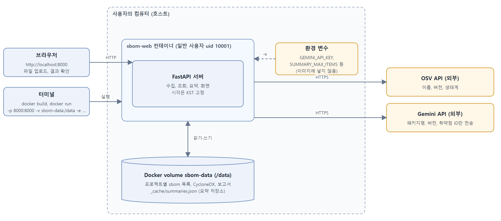
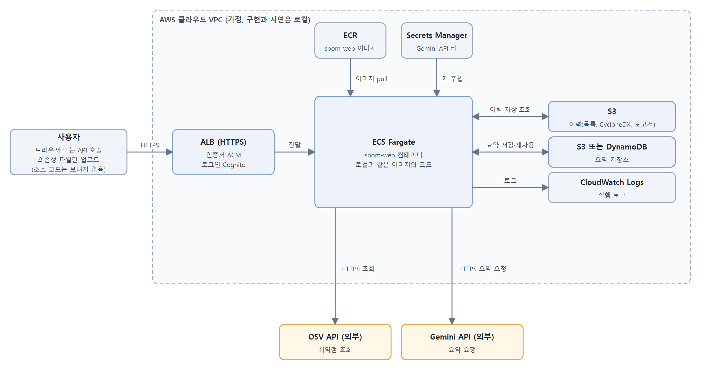

# SBOM 작성 + 취약점 점검 도구 개발 문서

코드 저장소: `https://github.com/jjin2024/final_sbom-web` (사례 전문과 변경 기록 전문은 `docs/appendix.md`)

| 항목 | 내용 |
|---|---|
| 하는 일 | 의존성 파일 1개를 올리면 구성요소 목록(SBOM) 작성, 취약점 조회, AI 요약, 이전 점검과 비교 |
| 입력 / 출력 | requirements.txt, package-lock.json, package.json, go.mod, Cargo.lock / 목록(txt), CycloneDX 1.5(json), 취약점 보고서(txt) |
| 구현 | FastAPI + Docker, 이력은 volume 파일, 외부 연동은 OSV와 Gemini |
| 결과 | 완료 기준 82개 사례 확인, 자동 시험 396건 통과 |

## 1. 문제, 사용자, 시나리오 정의

- 대상 사용자: 개발자, 보안 담당자
- 개발 방식: Spiral 모델(회전별 기록은 부록 A)
- 문제: 오랜 기간 혹은 AI를 활용해 개발하다 보면 어떤 패키지를 어떤 버전으로 썼는지 잊는다. 취약점은 매일 나오는데 개발할 때마다 직접 SBOM을 쓰고 갱신하기는 어렵다. 취약점 ID만으로는 영향과 올려야 할 버전을 알기 어렵고, 점검 결과를 남기지 않으면 지난번과 무엇이 달라졌는지 알 수 없다.
- 사용 상황 예시: 
  - 개발자가 `requirements.txt`를 올려 패키지 목록을 얻고, 취약점이 있는 패키지와 올려야 할 버전을 확인한다. 의존성을 바꾼 뒤 다시 올려 지난번과 달라진 점을 확인한다. 
  - 보안 담당자는 프로젝트별 이력과 표준 형식(CycloneDX) 파일을 받아 다른 도구나 보고에 넘긴다.
- "SBOM"의 범위: 업로드한 파일에 적힌 구성요소의 목록이다. 선언 파일(requirements.txt, package.json, go.mod)은 직접 의존성만, 잠금 파일(package-lock.json, Cargo.lock)은 전이 의존성까지 포함한다. 해시, 라이선스, 공급자는 포함하지 않는다.

| 불편 | 해결 | 사용 시나리오 |
|---|---|---|
| 패키지와 버전을 파악하기 어렵다 | 목록 자동 생성, 표준 형식(CycloneDX) 출력 | 파일을 올리면 목록이 저장되고 CycloneDX로 내려받는다 |
| 취약한 버전을 쓰는지 모른다 | OSV 조회, 심각도 순 표 | 취약 항목을 심각도 순으로 화면에 15행, 보고서에 전체 |
| 조치를 모른다 | AI 요약(설명, 업그레이드 권장) | 심각도가 높은 항목부터 요약. 실패해도 표는 유지 |
| 지난번과의 차이를 모른다 | 프로젝트별 이력과 이전 실행 대비 | 직전 목록과 비교해 추가·삭제·변경을 확인, 과거 결과를 내려받는다 |

## 2. 요구사항과 완료 기준

### 2.1 요구사항과 우선순위
기본 규칙: 파일 하나와 프로젝트 이름을 받는다. 
결과는 서버(컨테이너)의 데이터 폴더 `/data/<프로젝트>/`에 `sbom-<시각>.txt`, `sbom-<시각>.cdx.json`, `vuln-report-<시각>.txt`로 저장하고(시각은 KST), 사용자는 화면의 링크로 내려받는다. 업로드한 원본은 저장하지 않는다. 서버는 요청 사이에 상태를 기억하지 않는다.

우선순위: 1(핵심), 2(사용성과 신뢰성), 3(확장)

| 번호 | 요구사항 | 우선순위 |
|---|---|---|
| R1 | 업로드한 파일에서 패키지와 버전 수집 | 1 |
| R1-2 | 입력 검증과 오류 안내(이름, 파일 유무, 크기 1MB, 텍스트, 형식 오류, 패키지 0건) | 1 |
| R1-3, R1-4 | 확정 버전 아닌 항목(범위 표기)은 표시하고 조회 제외, 해석할 수 없는 줄은 건너뛰고 개수 안내, extras 해석 | 2 |
| R1-5 | 입력 형식 확대: package-lock.json, package.json, go.mod, Cargo.lock | 3 |
| R2 | 목록을 프로젝트별 `sbom-<시각>.txt`에 저장, 스캔 ID 반환 | 1 |
| R2-2, R2-3 | 이력 목록과 과거 파일 내려받기, 재요청은 새 파일을 만들고 기존 파일 유지, 같은 시각 충돌 거절 | 2 |
| R2-4 | 직전 목록과 비교해 추가·삭제·버전 변경 표시 | 2 |
| R2-5 | 구성요소 목록을 CycloneDX 1.5 JSON으로 저장·내려받기 | 3 |
| R3, R3-2 | 패키지·버전·생태계로 OSV 조회(중복 제거, 동시 조회), 표(상위 15행)와 보고서(전체) | 1 |
| R3-3 | 조회 실패 시 목록 파일 유지, 실패 안내(502) | 1 |
| R4 | 심각도 높은 순 최대 50건을 5건씩 묶어 Gemini로 요약, 한도 초과 항목은 표에 명시 | 1 |
| R4-2 | 요약 실패는 항목별로 표시하고 표는 유지, HTTP 429·401·403이면 남은 묶음 요청 중단 | 1 |
| R4-3 | 요약한 항목은 저장해 두고 재사용, 호출 수·재사용 수 표시 | 3 |
| R5 | Docker 이미지로 실행, 이력은 volume에 유지 | 1 |
| R6, R6-2 | 브라우저에서 업로드·결과·이력·다운로드 링크·오류 사유 표시 | 1, 2 |

구현하지 않은 것과 이유:

- 여러 파일 동시 업로드: 파일별 출처를 기록하고 중복 처리 규칙을 정해야 한다.
- 선언 파일의 전이 의존성: 패키지 레지스트리를 따로 조회해야 한다.
- CycloneDX에 취약점 포함: 취약점은 보고서에 따로 있어서 구성요소 목록만 담았다.
- 소스 코드 import 분석: 버전을 알 수 없다.
- 자동 업데이트: 사용자의 파일을 수정하는 위험이 크다.
- 인증·주기 실행: 이번은 로컬 단일 사용자 데모이다(외부 공개 구조는 3.4).
- GitHub 연동: 변경된 파일만 조회하면 파일이 그대로여도 새로 등록되는 취약점을 놓친다.
- 토큰 부족 등 원인별 AI 실패 처리: 재현해서 시험하기 어려워 정상 완료가 아니면 모두 요약 실패로 처리한다.

출력 형식: 
- 목록 파일은 헤더(프로젝트, 실행 시각 KST), `이름 버전 생태계` 항목 줄, 끝에 "이전 실행 대비" 구역이다. 
- 보고서는 전체 취약점, 항목별 요약 상태와 요약, 집계이다. 화면은 같은 내용을 표와 링크로 보여 준다.

### 2.2 완료 기준
외부 API는 실제 응답이 바뀌고 Gemini는 호출 한도가 있어서 고정한 가짜 응답으로 먼저 확인했고, 실제 OSV와 Gemini는 일부 사례에서만 확인했다. 사례는 82개이고 시작 상태, 사용자 행동, 기대 결과의 전문은 저장소의 `docs/appendix.md` 부록 B에 있다. 아래 표는 요구사항별 대표 조건과 기대 결과이고, 표 아래에 대표 사례 5개를 전체 형식으로 적었다.

테스트 입력: A(`flask==3.0.0`, `requests==2.31.0`), B(범위 표기 포함), D(A에 `django==4.2.0`, `click==8.1.7` 추가), F(`flask`, `requests`, `django`, `numpy`, `pillow`). 고정 응답: D(flask 높음, requests 보통, django 낮음), E(취약점 없음).

| 요구사항 | 사례 | 조건 → 기대 결과 |
|---|---|---|
| R1 | 1, 2 | A 업로드 → 201, 수집 2건, `sbom-<시각>.txt` 생성, 원본은 저장하지 않음 |
| R1-2 | 3~7, 57, 64 | 잘못된 이름, 파일 없음, 빈 파일, 상한 초과, 바이너리, 형식 오류 → 400 또는 413과 사유, 아무것도 저장하지 않고 조회 0회 |
| R1-3, R1-4 | 8, 9, 54, 66~68 | 범위 표기, 해석할 수 없는 줄, extras → 확정 버전 아님으로 표시하고 조회 제외, 건너뛴 줄 수 안내, extras는 이름과 버전으로 읽음 |
| R1-5 | 53~56, 58, 59, 62, 65, 72 | package-lock.json, package.json, go.mod, Cargo.lock → 형식별 수집과 purl, 같은 패키지가 여러 위치에 있어도 조회 1회 |
| R2 | 10~12 | UTC 서버에서 A → 파일명 시각이 KST, 프로젝트별 폴더, 읽기 전용이면 500 "저장 실패"와 불완전한 파일 없음 |
| R2-2, R2-3 | 13~17 | 이력 3건 최신순, 없는 스캔은 404, 재업로드는 새 파일 세트(기존 불변), 같은 시각 충돌은 409 |
| R2-4 | 18~22, 60, 69~71 | 일부를 바꾼 파일 → 추가 1, 삭제 1, 변경 1(`flask 3.0.0 -> 3.0.1`), 첫 요청은 "비교 대상 없음", PyPI 이름 표기 차이는 변경 없음 |
| R2-5 | 45~52 | A → CycloneDX 1.5(공식 스키마 통과), 확정 버전 아닌 항목은 `version` 없이 기록, 저장 실패는 경고, 화면 링크로 내려받기 |
| R3 | 23~25, 61~63 | D → 취약점 3건, 중복 조회 제거, 실제 OSV에서 `requests 2.31.0`과 npm·Go·crates.io 패키지가 1건 이상, 동시 조회와 순서대로 조회의 결과가 같음 |
| R3-2, R3-3 | 26~30, 73 | 표는 심각도 순 15행과 "외 N건은 보고서 참조", 보고서는 전체, 조회 실패는 502와 목록 유지(새 보고서 없음), 응답 표에 생태계 열 |
| R4 | 31~36 | 요약 한도와 5건 묶음 → 한도 초과는 "요약 제외", 요청 본문에 패키지명·버전·취약점 ID만, 키가 없으면 요약 건너뜀 |
| R4-2 | 37~39, 79 | 일부 묶음 오류 → 나머지 묶음은 계속 요약하고 표 유지, 429·401·403이면 첫 묶음에서 중단하고 남은 항목은 "요약 실패" |
| R4-3 | 74~78, 80~82 | 같은 파일을 두 번 → 두 번째는 Gemini 호출 0회와 "요약됨(재사용)", 깨진 캐시·만료·키 없음 처리, 프로젝트 사이 공유 |
| R5 | 40~42 | Docker 실행 → `/healthz` 200, 컨테이너를 지우고 같은 volume으로 재실행해도 이력 유지, 이미지에 키 없음 |
| R6, R6-2 | 43, 44, 52, 65, 82 | 브라우저에서 결과·링크·이력 확인, 빈 파일은 사유만 표시(내부 정보 없음), 375px 가로 넘침 없음 |

전체 형식으로 적은 대표 사례(시작 상태, 사용자 행동, 기대 결과). 나머지 사례의 전문은 저장소의 `docs/appendix.md` 부록 B에 있다.

| 번호 | 요구사항 | 시작 상태 | 사용자 행동 | 기대 결과 |
|---|---|---|---|---|
| 19 | R2-4 | demo에 A로 만든 스캔 1개 | `flask==3.0.1`, `click==8.1.7` 두 줄로 바꾼 파일을 demo에 업로드(requests 줄 삭제) | 응답과 새 `sbom-<시각>.txt`의 `## 이전 실행 대비` 구역에 같은 내용: 추가 1(`click 8.1.7`), 삭제 1(`requests 2.31.0`), 변경 1(`flask 3.0.0 -> 3.0.1`), 변경 없음 0 |
| 26 | R3-2 | 응답 세트 D | demo에 D 업로드 | 응답의 표 순서: TEST-0001(높음), TEST-0002(보통), TEST-0003(낮음). 열: 패키지, 버전, 생태계, 취약점 ID, 심각도, 요약 상태, 요약. `vuln-report-<시각>.txt`가 있고, 파일명 시각이 같은 요청의 `sbom-<시각>.txt`와 같음 |
| 37 | R4-2 | 취약점 12건이 나오는 고정 응답, 두 번째 요청만 오류를 돌려주는 가짜 Gemini | demo에 업로드 | Gemini 요청 3회(오류 뒤에도 셋째 요청이 감). 첫째·셋째 묶음 7건은 "요약됨"(요약문 있음), 둘째 묶음 5건은 "요약 실패". 집계 `요약 7건 성공, 5건 실패, 0건 제외`. 표와 `vuln-report-<시각>.txt`에 12건 모두 있음 |
| 41 | R5 | 사례 40 직후 demo에 스캔 1개 | `docker rm -f sbom-web` 후 같은 volume(`sbom-data`)으로 다시 `docker run`, 변경한 파일을 demo에 업로드 | 이력 목록에 이전 스캔이 남아 있음. 응답의 이전 실행 대비가 그 스캔 기준으로 표시됨(컨테이너를 지워도 이력 유지) |
| 74 | R4-3 | 응답 세트: 취약점 7건, 정상 응답하는 가짜 Gemini, API 키 설정 | demo에 같은 파일을 두 번 올림(시각이 다름) | 첫 번째는 Gemini 호출 2회(5건, 2건), 7건 모두 "요약됨", `summary.calls` 2, `reused` 0. 두 번째는 Gemini 호출 0회(총 2회 그대로), 7건 모두 "요약됨(재사용)"이고 요약문이 첫 번째와 같음, 집계 `요약 7건 성공, 0건 실패, 0건 제외`, `calls` 0, `reused` 7. 보고서의 `## 요약 집계`에 `요약 호출 0회, 재사용 7건` 줄, 항목 줄에 `[요약됨(재사용)]` |

## 3. 프로그램 설계

### 3.1 구성요소와 책임
Python과 FastAPI로 구현했고 화면은 서버가 내려주는 HTML 한 장이다. 이력은 DB 없이 데이터 폴더의 파일로 보관한다. OSV와 Gemini 호출은 별도 부분으로 분리해 테스트에서 가짜 응답으로 바꿔 끼운다.

| 구성요소 | 맡을 일 | 파일 |
|---|---|---|
| API 계층 | 요청 검증, 시각(KST) 결정, 단계 호출, 오류를 상태 코드로 변환 | `app/main.py` |
| 파일 해석 | 파일 이름으로 형식을 정해 패키지 항목(이름, 버전, 생태계) 생성 | `app/parser.py` |
| 이력 저장소 | 목록·CycloneDX·보고서 저장(같은 시각 충돌 검사), 이력 목록 | `app/storage.py` |
| 비교 | 직전 목록과 추가·삭제·변경 비교 | `app/compare.py` |
| 표준 형식 출력 | CycloneDX 1.5 구성요소와 purl | `app/cyclonedx.py` |
| 취약점 조회 | 중복 제거, OSV 동시 조회, 별칭 합치기, 심각도 변환 | `app/osv.py`, `app/severity.py` |
| AI 요약 | 5건씩 Gemini 요청, 묶음별 상태, 429·401·403이면 중단 | `app/summary.py` |
| 요약 저장소 | 요약문 저장·재사용(30일) | `app/summary_cache.py` |
| 보고서·표 | 심각도 정렬, 표 15행, 보고서 | `app/report.py` |
| 화면 | 요청 폼, 결과·이력·오류 표시 | `app/static/index.html` |

### 3.2 데이터 흐름
대표 요청: 프로젝트 `demo`에 파일 D를 올린다.

| 단계 | 구성요소 | 처리 | 결과 |
|---|---|---|---|
| 1 | API 계층 | 이름·파일·크기·텍스트 검증 | 실패하면 오류 응답 |
| 2 | 파일 해석 | 파일 이름으로 형식을 정해 해석 | 패키지 항목, 건너뛴 수 |
| 3 | 이력 저장소·비교 | 직전 파일과 비교, 목록과 CycloneDX 저장 | 목록, CycloneDX, 비교 결과 |
| 4 | 취약점 조회 | 중복 제거해 OSV 동시 조회 | 취약점 목록(실패하면 502) |
| 5 | AI 요약 | 상위 50건 중 저장된 요약은 재사용, 나머지를 5건씩 요청 | 항목별 요약과 상태, 집계 |
| 6 | 보고서·표 | 표 15행, 보고서 저장 | `vuln-report-<시각>.txt` |
| 7 | API 계층 | 응답 구성 | 결과 JSON, 화면 표시 |

실패 때의 흐름: 입력 검증 실패는 아무것도 만들지 않고, 같은 시각 충돌은 409, 조회 실패는 목록 유지·보고서 없이 502, 요약 실패는 해당 묶음만 실패(429·401·403이면 남은 묶음 중단), 보고서나 CycloneDX 저장 실패는 경고를 담은 정상 응답이다.

### 3.3 실행과 배포 구조
FastAPI 서버와 화면을 Docker 이미지로 만들어 컨테이너로 실행하는 웹 서비스이다(인증 없는 단일 사용자 데모). 웹 서비스를 택한 이유는 사용자가 브라우저에서 파일 하나만 올리면 되고, API 키를 서버가 보관해 사용자 컴퓨터에 배포하지 않으며(외부로 가는 정보는 패키지명, 버전, 취약점 ID뿐), 이력이 volume에만 남아 컨테이너를 지워도 유지되고, 같은 이미지를 클라우드로 옮길 수 있기 때문이다. 인증이 없으므로 외부에 공개하지 않고 로컬에서만 실행한다.

그림 3.3 실행과 배포 구조



| 메서드 | 경로 | 설명 |
|---|---|---|
| POST | `/api/projects/{project}/scans` | 파일을 올려 수집·저장·조회·요약(201, 400, 409, 413, 500, 502) |
| GET | `/api/projects/{project}/scans` | 이력 목록(최신순) |
| GET | `/api/projects/{project}/scans/{scan_id}/sbom`, `/report`, `/cyclonedx` | 파일 내려받기 |
| GET | `/`, `/healthz` | 화면, 기동 확인 |

### 3.4 클라우드 확장 구상
같은 이미지를 클라우드로 옮길 때의 설계이다. 구현과 시연은 로컬이다.

그림 3.4 서비스형(가정)의 클라우드 구조



| 항목 | 현재 구현 | 서비스형(가정) |
|---|---|---|
| 접근 제어 | 없음(로컬 단일 사용자) | Cognito 로그인, 사용자별 이력 분리 |
| 이력과 요약 저장 | volume의 파일(`/data`) | S3, 요약 저장소는 S3 또는 DynamoDB |
| API 키 | `-e GEMINI_API_KEY` | Secrets Manager에서 주입 |
| 서버 수와 처리 | 컨테이너 1개, 요청 안에서 동기 처리 | Fargate 태스크 여러 개 + ALB, 필요하면 큐 기반 비동기 처리 |

## 4. 변경 기록
변경한 내용과 이유이고, 계기(외부 피드백, 자기 점검, 테스트 결과, 요구 변경)를 함께 적었다.

| 변경한 내용 | 이유 | 계기 |
|---|---|---|
| 요약 실패를 항목별 상태와 집계로 표시하고 묶음 단위 부분 성공 처리(R4-2) | 어디까지 됐고 어디부터 안 됐는지 구분해 달라는 피드백 | 외부 피드백 |
| 토큰 부족 전용 처리는 배제하고 정상 완료가 아니면 모두 요약 실패로 통합, 재현 가능한 방식(작은 출력 토큰, 잘못된 키, 네트워크 차단)으로 시험 | 토큰 부족은 재현하기 어려우니 시험 방법을 생각하고 안 되면 배제하라는 피드백 | 외부 피드백 |
| 요약 대상을 심각도 순 최대 50건, 5건씩 묶음으로 제한(R4) | CVE가 많아질수록 입력이 커지므로 한도를 두라는 피드백 | 외부 피드백 |
| 터미널 도구(CLI)에서 웹 서비스로 변경, 입력을 폴더 탐색에서 파일 업로드(프로젝트 이름 포함)로, 저장 위치를 서버 volume으로 변경 | 터미널과 Docker 옵션을 알아야 해 사용성이 낮고, 웹에서는 사용자 폴더를 읽을 수 없음. 직전 요청과 비교하려면 프로젝트 구분이 필요함 | 자기 점검 |
| 폴더 탐색·`.gitignore` 요구사항 삭제, 이력 조회와 화면 요구사항 추가 | 업로드가 파일 1개라 탐색이 없고 이력과 화면이 필요함 | 자기 점검 |
| 입력을 requirements.txt로 한정했다가 package-lock.json, package.json, go.mod, Cargo.lock으로 확대(R1-5), 업로드 상한 256KB→1MB | 처음에는 마칠 수 있는 범위로 줄였고, 실제 잠금 파일이 수백 KB였음 | 자기 점검, 테스트 결과 |
| OSV 별칭(GHSA, PYSEC)을 하나로 합치고, 조회 실패는 부분 결과 없이 전체 502, 병렬 조회(기본 8) | 이중 등록이 건수와 요약 한도를 부풀림. 큰 잠금 파일 점검이 너무 오래 걸림(5.2) | 테스트 결과 |
| Gemini는 SDK 없이 직접 HTTP로 호출, 정상 완료는 `finishReason`이 `STOP`일 때만 | SDK 의존성과 실패 판정 통제. 처음 가정한 모델이 404였던 것은 실제 호출로 발견함 | 테스트 결과 |
| 화면은 Manus가 만든 터미널 스타일 HTML을 읽고 실행해 스크립트 오류와 접근성 문제를 고치고 이력·링크·비교·집계를 추가 | AI가 만든 화면을 그대로 쓰지 않고 검증함 | 자기 점검 |
| CycloneDX 1.5 출력 추가, 공식 스키마로 검증 | 표준 형식으로 다른 도구에 넘길 수 있어야 함 | 요구 변경 |
| extras 해석과 PyPI 이름 정규화, go.mod의 정상 줄을 건너뛴 줄로 세지 않음, 응답 표와 화면에 생태계 열 추가 | 실제 파일에 흔한 표기, 표기만 달라도 삭제와 추가로 보이던 문제, 정상 파일에도 경고가 나던 문제 | 자기 점검, 테스트 결과 |
| 요약 재사용(30일)과 429·401·403이면 남은 묶음 중단 추가, 응답에 호출 수와 재사용 수 표시 | 무료 키의 하루 한도(모델당 20회)에서 같은 취약점을 다시 요약하는 호출을 줄임 | 테스트 결과 |

## 5. 테스트를 통한 개선 기록

### 5.1 시험 결과
자동 시험은 396건 통과, 7건 건너뜀이다. 건너뛴 7건은 실제 OSV(5건)와 실제 Gemini(2건)를 부르는 시험이라 환경 변수가 있을 때만 실행하며, 기본 실행에서 실패하는 시험은 없다. 완료 기준 82개 사례는 모두 기대 결과대로 확인했다.

| 확인 방법 | 사례 |
|---|---|
| 자동 시험(가짜 응답) | 1~39, 45~51, 53~64, 66~82 |
| 실제 OSV, 실제 Gemini | 25, 61 / 39, 74 |
| Docker 컨테이너(최종 이미지) | 12, 30, 40~42, 74~81 |
| 브라우저(1280px, 375px) | 43, 44, 52, 65, 82 |

### 5.2 발견한 문제와 수정
가짜 응답 시험이 못 잡은 문제는 실제 서비스 호출과 컨테이너·브라우저 확인에서 나왔다.

| 발견한 문제 | 수정 | 재시험 결과 |
|---|---|---|
| 처음 가정한 Gemini 모델이 404였고, 첫 요청은 60초 시간 초과 | 모델을 `gemini-3.5-flash`로 바꾸고(환경 변수로 변경 가능) 생각 수준을 `low`로 낮춤 | 응답 2~4초, 5건 묶음 5.6초 |
| 같은 취약점이 GHSA와 PYSEC로 이중 등록되어 건수가 부풀음 | 별칭이 겹치면 하나로 합침 | 두 패키지가 합쳐 8건에서 4건(사례 25) |
| Manus 화면의 스크립트 문법 오류와 접근성 문제 | 오류 한 줄 수정, 라벨 연결, 글자 12px 이상 | 화면 상태 7종 확인, 375px 가로 넘침 없음 |
| 사례 39 시험이 실패 사유(토큰 부족인지 429인지)를 구분하지 못함 | 서버 로그의 `not completed`까지 확인하도록 시험 강화 | 첫날은 하루 한도로 미통과, 다음 날 통과 |
| 무료 키 하루 한도(모델당 20회)로 요약이 전부 실패 | 429·401·403이면 남은 묶음 중단, 요약 재사용 추가 | 첫 업로드 호출 1회, 이후 0회 |
| 실제 잠금 파일(조회 443건)이 순서대로 217.8초 | OSV를 8개 동시에 조회 | 27.3초, 결과 동일(사례 63) |
| 정상 go.mod에도 "건너뛴 줄 N건" 경고 | 읽을 수 없는 줄만 세도록 변경 | 사례 55는 0건, 사례 72 통과 |

### 5.3 기대 결과와 실제 결과
| 사례 | 조건 | 기대 결과 | 실제 결과 |
|---|---|---|---|
| 19 | A 업로드 후 일부를 바꾼 파일 업로드 | 추가 1, 삭제 1, 변경 1 | 통과. numpy 추가, click 삭제, `flask 3.0.0 -> 3.0.1`, 변경 없음 2 |
| 25 | 실제 OSV에 `requests==2.31.0` | 취약점 1건 이상 | 별칭을 합친 뒤 3건 |
| 28 | 취약점이 표 한도보다 많음 | 표 15행과 "외 N건은 보고서 참조" | 통과. 실제 OSV 55건에서 15행과 "외 40건" |
| 41 | 컨테이너를 지우고 같은 volume으로 재실행 | 이력과 이전 실행 대비 유지 | 통과. 이력 2건, 비교 "비교함" |
| 74 | 실제 Gemini, 같은 파일을 두 번 업로드 | 두 번째는 호출 0회, "요약됨(재사용)" | 통과. 호출 1회 → 0회 → 재시작 뒤 0회 |
| 전체 | `pytest` 기본 실행 | 실패 0건 | 396건 통과, 7건 건너뜀 |

### 5.4 남은 문제
| 문제 | 영향과 대응 |
|---|---|
| 무료 Gemini 키는 모델당 하루 20회 한도 | 한도가 차면 요약만 "요약 실패"이고 표·이력은 정상. 429이면 남은 묶음 요청 중단, 시연은 5건과 요약 재사용으로 피함 |
| 50건 규모(Gemini 10회 호출)의 전체 응답 시간은 확인하지 못함 | 5건 묶음은 실제 호출로 확인(5.6초). 요약이 묶음마다 순서대로 일어나고 서버가 요청을 하나씩 처리함 |
| 한 번에 파일 하나만 올릴 수 있음(예: 백엔드 `requirements.txt`와 프런트엔드 `package-lock.json`이 있는 큰 프로젝트) | 파일마다 프로젝트 이름을 나눠 따로 점검해야 한다. 보완 방향: 여러 파일을 한 번의 점검으로 받아 파일별 출처를 기록하고 중복 처리 규칙을 정한다. |
| 선언 파일은 직접 의존성만 담고, CycloneDX에는 취약점 정보가 없음 | 잠금 파일을 올리면 전이 의존성까지 보임 |
| 최근에 공개된 취약점은 Gemini가 내용을 모를 수 있음 | 실제 화면 확인에서 요약 5건 중 3건이 "확인 필요"로 나옴. 추측하지 않도록 한 의도된 동작이고 표와 보고서는 OSV 결과 그대로임 |
| 요약 저장소는 컨테이너 1개 전제, 30일 안에는 OSV 설명이 바뀌어도 갱신되지 않음 | 서비스형에서는 S3 또는 DynamoDB(3.4). 재사용 기간을 줄일 수 있음 |
| 미확인: 화면에서 409·413을 직접 만들지 않음, 실제 OSV·Gemini 시험 7건은 환경 변수가 있을 때만 실행 | 서버 쪽은 시험했고 실제 호출은 직접 실행해 통과를 확인함 |

## 6. 실행 및 사용 안내
제공 자료는 GitHub 저장소 `https://github.com/jjin2024/final_sbom-web`(소스, `Dockerfile`, `README.md`, `tests/`, `docs/`)이다.

### 6.1 준비물
Docker Desktop(실행 중), 웹 브라우저, 인터넷 연결(OSV와 Gemini 접속). Gemini API 키가 없어도 서버는 실행되고 AI 요약만 건너뛴다.

### 6.2 실행
저장소를 내려받아(`git clone https://github.com/jjin2024/final_sbom-web.git`) 저장소 폴더에서 실행한다(Windows PowerShell 기준).

```powershell
docker build -t sbom-web .
$env:GEMINI_API_KEY = "발급받은키"   # API 키 없으면, 요약만 없이 동작
docker run -d --name sbom-web -p 8000:8000 -v sbom-data:/data -e GEMINI_API_KEY -e SUMMARY_MAX_ITEMS=5 sbom-web
```

- 접속: 브라우저로 `http://localhost:8000`, 기동 확인은 `http://localhost:8000/healthz`(200)
- `-v sbom-data:/data`가 이력 보관 위치이다. 빼면 컨테이너를 지울 때 이력도 사라진다.
- `SUMMARY_MAX_ITEMS=5`는 요약할 취약점을 5건으로 줄인다(점검 1번에 Gemini 호출 1회). 기본은 50이다.

### 6.3 사용 방법
1. 화면의 `project_name`에 프로젝트 이름을 입력하고 `package_file`에서 의존성 파일을 선택한다. 연습용 `requirements.txt`: `flask==3.0.0`, `requests==2.31.0`, `django==4.2.0`, `click==8.1.7`
2. `RUN VULNERABILITY SCAN`을 누른다. 수집 건수, 이전 실행 대비, 취약점 표(심각도 순 15행), 요약 집계, 다운로드 링크(sbom, report, cyclonedx)가 나온다.
3. 같은 프로젝트 이름으로 파일을 조금 바꿔 다시 올리면(1초 이상 간격) 이전 실행 대비가 나온다. `LOAD HISTORY`로 과거 점검을 보고 내려받는다.
4. API로도 쓸 수 있다: `curl -F "file=@requirements.txt" http://localhost:8000/api/projects/demo/scans`

### 6.4 환경 변수
모두 선택이다. 전체 목록은 저장소의 `README.md`에 있다.

| 이름 | 기본값 | 설명 |
|---|---|---|
| `GEMINI_API_KEY` | (없음) | Gemini API 키. 없으면 요약만 건너뜀 |
| `SUMMARY_MAX_ITEMS` | `50` | 요약할 최대 취약점 수 |
| `SUMMARY_CACHE_TTL_DAYS` | `30` | 요약 재사용 기간(일). 0이면 쓰지 않음 |
| `GEMINI_MODEL` | `gemini-3.5-flash` | 요약 모델 |

### 6.5 문제가 생기면
| 증상 | 해결 |
|---|---|
| 포트 8000이 사용 중 | `-p 8001:8000`으로 실행하고 `http://localhost:8001`로 접속한다. |
| 컨테이너 이름이 이미 있음 | `docker rm -f sbom-web` 후 다시 실행한다(이력은 volume에 남는다). |
| 요약이 "요약 안 함(API 키 없음)" | 키를 설정하고 다시 실행한다. |
| 요약이 "요약 실패" | `docker logs sbom-web`에서 원인을 본다. `HTTP 429`는 하루 한도 초과이다. 기다리거나 `-e GEMINI_MODEL=gemini-3.1-flash-lite`로 모델을 바꾼다. |
| "조회 실패, 목록은 저장됨"(502) | 인터넷 연결을 확인하고 다시 시도한다. |
| 같은 프로젝트에 연속 업로드해 409 | 1초 뒤 다시 올린다. |

정리: `docker rm -f sbom-web`, 이력까지 지우려면 `docker volume rm sbom-data`. 시험은 `python -m venv .venv`, `.venv/Scripts/python -m pip install -r requirements-dev.txt`, `.venv/Scripts/python -m pytest -q`로 실행한다(외부 호출 없이 396건 통과).

## 부록

### A. 개발 방식
Spiral 모델이다. 회전마다 가장 큰 위험을 먼저 확인하고 구현과 시험으로 검증한 뒤 다음 요구를 정했다.

| 회전 | 시기 | 한 일 | 가장 큰 위험과 대응 |
|---|---|---|---|
| 1 | 11/2 | 요구사항, 완료 기준, 설계 초안(CLI 형태) | 범위가 큼 → 입력을 requirements.txt 하나로 줄임, Peer review 반영 |
| 2 | 11/9 오전 | 웹 서비스로 전환, 서버·조회·이력·요약·Docker·화면 구현 | 사용성, 폴더 접근 불가, 실제 Gemini 호출 실패 → 업로드 방식, 실제 호출로 설정 확정 |
| 3 | 11/9 오후 | CycloneDX, 입력 5종, 병렬 조회 | 큰 잠금 파일의 조회 시간 → 동시 조회 |
| 4 | 11/10 | 요약 재사용, 429 중단 | 무료 키의 하루 20회 한도 → 재사용, 실제 호출 1회→0회 확인 |

### B. AI 도구 사용
| 날짜 | 사용한 곳 | 내용 |
|---|---|---|
| 2026-11-02 | Claude | 주제 검토, 시나리오·요구사항·완료 기준·설계 초안 작성과 보완 |
| 2026-11-09 | Claude | 웹 서비스 전환 검토, 문서 개정, 클라우드 활용 설명 작성 |
| 2026-11-09~12 | Claude Code | 설계에 따른 구현과 시험, 실제 OSV·Gemini 호출 확인, 문서 정리 |
| 2026-11-09 | Manus | 화면 초안 생성(스크립트 오류와 접근성 문제는 Claude Code로 수정) |

AI가 만든 코드, 화면, 문서의 검증 방법과 결과는 4장과 5장에 있다.
